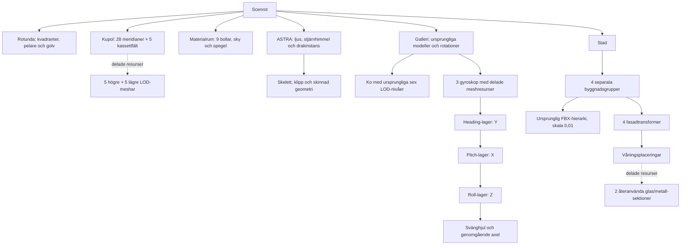

# Pantheon – stora temarum och återanvända objekt

En avgränsad scenprototyp för den befintliga C++/OpenGL-viewern. Rotundan
har kvar sin scenegraph, kupol, oculus och LOD; sidorummen har byggts ut
för den gamla scenens modeller och materialdemonstrationer.

Scen, modeller och gyroskopanimationer ligger i `experiments/pantheon`.
Biblioteket har generell registrering av XML-animationer och stöd för rumsspecifika
skyboxar. Experimentets startfil registrerar gyroskopens callbacks. Skyboxpasset,
reflektioner och diffus IBL använder scenens deklarerade miljöer och öppningar.
Den vanliga viewern innehåller ingen gyroskopspecifik kod. Standardscenen
`scenes/house-patio.xml` är oförändrad och fortsätter använda en global HDRI.
Tidigare versioners scen, generator och resultat finns i
`history/v1`, `history/v2`, `history/v3` och `history/v4`. Inga nya modellpaket eller tjänster behövs vid körning.

Alla fyra rum har uttryckliga miljögränser så att skyboxar följer både det
egna rummets och destinationsrummets öppning. Lokala cubemaps uppdateras vid
rumsbyte; fasadvåningar delar en probe per byggnad. C-3PO och Altaïr är nu
cirka 5,5 meter höga med större socklar. Kalksten och marmorgolv har tydligare
normalmappar. [Senaste kontroller och bilder](RESULTAT.md).

## Start och vyer

Från repots rot:

```powershell
.\experiments\pantheon\build.ps1
.\experiments\pantheon\run.ps1
.\experiments\pantheon\run.ps1 -NoVsync
.\experiments\pantheon\run.ps1 -View materials
.\experiments\pantheon\run.ps1 -View mirror
.\experiments\pantheon\run.ps1 -View city
.\experiments\pantheon\run.ps1 -View dragon
.\experiments\pantheon\run.ps1 -View gallery
.\experiments\pantheon\run.ps1 -View gyroscopes
.\experiments\pantheon\run.ps1 -View euler
.\experiments\pantheon\run.ps1 -View axis-angle
.\experiments\pantheon\run.ps1 -View quaternion
.\experiments\pantheon\run.ps1 -View astra-exit
.\experiments\pantheon\run.ps1 -View astra-sky
.\experiments\pantheon\run.ps1 -View city-sky
```

De tidigare vynamnen `lapis`, `aes`, `silva` och `astra` fungerar också.
`rotunda` och `dome` visar centralrummet. `mirror` visar spegelväggen inifrån
materialrummet. Alla vyer laddar hela scenen och går att navigera vidare från.

Normalstarten använder **RelWithDebInfo** utan debugger.

**VSync** i den nedre menyraden eller **F7** växlar synkronisering med skärmens
uppdatering utan omstart. `-NoVsync` startar med den avstängd. Mätmedelvärdena
återställs vid byte. Profilens **Swap / VSync wait** mäter väntan i bufferbytet,
inklusive presentations- och drivrutinsväntan. En hög andel kan vara ledig tid
fram till nästa skärmuppdatering. Med VSync av kan sådan väntan minska, men
GPU-beroenden och fönstersystemets presentation kan fortfarande ge väntetid.

Motorn återanvänder nu oförändrade skugglistor, hoppar över grenar utan ljus
och väljer skuggljus efter huvudbildens och hjälpvyernas mottagande ytor. Lokala
cubemaps filtreras stegvis och publiceras som kompletta resultat; detta ger
längre uppdateringslatens. AO använder 32 sampel, och picking återanvänder
oförändrade träffar. Se [mätning med vanlig HUD och VSync](RESULTAT.md) och
[råvärden](performance-frame-work.json).

Den vanliga starten visar HUD och menyer. Endast den dolda benchmarkkörningen
använder `--no-menus`. Tab döljer eller visar menyerna.

Höger musknapp + WASD flyttar kameran, Q/E flyttar i höjdled och Shift ökar
hastigheten. Space återställer den valda vyn. F1 visar prestanda, C växlar
culling, Tab visar menyerna och R läser om scenen. De gamla objektens
picking, subdivision, drakens animationsval och bilens strålkastarknappar
har behållits. Starten använder deferred, Cook–Torrance, FXAA, AO, skuggor
samt den befintliga HDRI:n för ljus och reflektioner.

Legacyrummets taklampor är ersatta med den ursprungliga roterande ljusringen,
som ligger under rummets delträd i scenegraphen. `1`–`4` och färgknapparna
växlar rött, grönt, blått och vitt ljus; `5` växlar solen. `T` eller knappen
**Light orbit** pausar/startar rotationen. Piltangenterna flyttar ringen i
sidled och Page Up/Page Down i höjdled. `F` fryser hela scenen och bevarar
ringens tidigare pausläge.

## Rummen

| Riktning / rum | Invändig storlek | Innehåll |
| --- | --- | --- |
| Norr / MATERIALS | Rund sal, 48 m diameter, 26 m höjd | Alla nio gamla materialbollar, glas, spegelvägg och den gamla molnhimlen |
| Öster / METROPOLIS | Gaturum 64 × 78 m | Fyra skyskrapor, glasfasader, Porsche i verklig storlek, trottoarer och planteringar |
| Söder / GALLERY | 42 × 44 m, 14 m höjd | Apor, ko med sex LOD-nivåer, torus, lådor, alpha-cutout, C-3PO, Altaïr och tre mekaniskt kopplade gyroskop |
| Väster / ASTRA | Rund sal, 48 m diameter, 30 m höjd | Den ursprungliga animerade draken, stjärnhimmel och en putsad utställningsö |

Anslutningsgångarna börjar vid rotundans fyra bågar och är cirka 13 m
långa. De stora salarna börjar 34 m från centrum; de ligger därför fria
från varandra. Den befintliga flygkamerans far plane är fortfarande 150 m.
Staden är avsiktligt liten och kan granskas från gatunivå.

Materialrummets spegelvägg är totalt 36 m bred och 12 m hög, med en
6,48 m bred genomgång i mitten. Den står på entrésidan och är vänd in mot
bollarna. Det ger fri passage och undviker spegelfångst från rotundan.
Båda spegelpartierna använder samma riktiga, fullupplösta plana reflektion.

## Tre rotationer från föreläsningen

Böcker, bokhyllor och den gamla armillarsfären är borttagna. Tre gyroskop
står bredvid varandra längst bak i galleriet. De delar maskinbearbetade meshresurser,
med fasade metallringar, ihåliga bronslager, koaxiala lagertappar och ett
ekrat svänghjul med genomgående axel. Figurerna står längs sidorna.

| Exemplar | Orientering och demonstration |
| --- | --- |
| Euler | Intrinsisk ordning Y–X–Z: heading, pitch, roll. Under sekund 4–12 i en 20-sekundersloop hålls pitch vid 90°. Heading och roll drivs lika mycket och tar ut varandra när axlarna sammanfaller. Ringarna fortsätter röra sig; en frihetsgrad har försvunnit. |
| Axel–vinkel | En normaliserad, snedställd axel och en vinkel som gör ett helt varv på 20 sekunder. Matrisen beräknas direkt med axel–vinkel. |
| Kvaternion | Normaliserade enhetskvaternioner och SLERP mellan direkt skrivna axel–vinkelposer. Tecknet väljs för kortaste bågen; orienteringen fortsätter genom 90°. Inga Euler-vinklar interpoleras eller matas tillbaka till rotationsspåret. |

Alla tre har delträdet **fast ok → heading-lager → pitch-lager → roll-lager →
svänghjul**. För axel–vinkel och kvaternioner beräknas ringarnas gångjärnsvinklar
med invers kinematik från den färdiga orienteringen. Detta är en mekanisk
visualisering: även en kvaternionstyrd fysisk gimbal kan få sammanfallande
axlar. Kvaternioner tar bort rotationsrepresentationens singularitet, inte
mekanikens. Testet mäter därför oberoende rotationsriktningar direkt från
kvaternionen, separat från ringarnas visning.

De tre metoderna har olika rörelsespår; detta är ingen jämförelse av identiska
styrsignaler. Det vänstra exemplaret visar den specifika Euler-singulariteten.
Föreläsningsunderlaget är `lectures/5dv180_lecture2_acceleration_visibility_processing.txt`,
avsnittet om rotationer (cirka rad 910–1410).

`gyroscopes` visar hela raden; `euler`, `axis-angle` och `quaternion` visar
närbilder. R börjar om rotationsloopen. F fryser scenen för närmare granskning
och F igen återupptar den. HUD och menyer visas vid vanlig start.


## Skala och glas inför en senare raytracer

De fyra befintliga FBX-modellerna `ResidentialBuildings006`, `007`, `009`
och `010` används som strukturella kärnor med **enhetlig skala 0,01**.
Deras importerade bounds har mätts med Assimp, inklusive nodtransformationer.
De blir cirka 12,59 × 23,10 m i plan och 47,19 / 68,79 / 86,79 / 104,79 m
höga. Byggnaderna står på marken och har centrerats från sina verkliga bounds.
Porschen har skala 1 och är cirka 1,98 × 4,55 m i plan.

De gamla modellerna har separata `hotel_glas`-ytor. Utöver dessa finns
**2 268 nya slutna glasrutor**, med **12 mm tjocklek**, IOR **1,52** och
roughness **0,055**. Glaset täcker cirka 67–71 procent av tornens totala
rektangulära fasadarea. Metallprofiler och glas är separata materialmeshar.
De gamla inbakade reflektionsfotona och den kraftiga stål-normalmappen har
kopplats bort för tornen. Reflektionerna kommer från renderingen.

Rutorna är verkliga triangelytor, inte ett fönstermönster i en textur. En
våningssektion med fem eller nio rutor delas av alla motsvarande våningar.
Därmed behövs inte en graphnod per ruta. De slutna rutornas kanter verifieras
geometriskt. De gamla FBX-kärnorna har däremot inga färdigmodellerade rum
bakom curtain wall-fasaden; det behöver hanteras om framtida strålspårning
ska visa interiörer eller full volymetrisk transmission.

`building_catalog.json` innehåller importerade mått och källfilernas SHA-256.
`scene-manifest.json` innehåller rumsmått, modellskala, fönsteryta,
glasparametrar, modellinventering och skyreferens. Ingen raytracer ingår här.

## Scenegraph och material



Varje rum är ett eget transformdelträd. Varje torn har en byggnadsgrupp,
ursprunglig FBX, fyra fasadtransformer och instanser av våningssektionerna.
Upprepningar delar vertexdata; rum, byggnader och våningar kan frustumcullas.
De befintliga render- och skuggcacherna samt instansieringen används.
`geometry.json` skiljer skrivna instansnoder från unika meshresurser; antalet
instansnoder är inte antalet draw calls och inkluderar LOD-alternativ.

Pantheons arkitektur har separata material för puts, ljus marmor, mörk
polerad sten och pelare. Färg- och OpenGL-normalmappar är 2K, höjdkartorna
1K. `F6` växlar höjdkartorna; normalmapparna används som reserv när bump
är av. Kassettkupolens LOD-nivåer delar texturskala, pelarnas UV följer
omkrets och höjd i meter, och listytor har UV i rätt ytplan.

Rumsskyltarna är mindre och visar endast **SPHERES**, **CITY**, **LEGACY**
eller **DRAGON**. Gyroskopens separata skyltar behåller sin storlek.

De tidigare materialfilerna finns kvar för sidorummen. CC0-källorna är
[Beige Wall 001](https://polyhaven.com/a/beige_wall_001),
[Marble 01](https://polyhaven.com/a/marble_01) och
[Grey Cartago 03](https://polyhaven.com/a/grey_cartago_03).
`materials.json` anger filer, upphovspersoner, licens, URL och checksumma.
`fetch_pantheon_materials.py` kan återställa just arkitekturens nio originalkartor;
generatorn och viewern kräver ingen nätanslutning.

## Riktiga skyboxar per rum

Öppningarna till dolda rum visar nu riktiga HDR-rendertexturer av respektive
destinationsdelträd. Kamerans projektion beskärs till öppningen, så texturen
följer betraktaren med korrekt perspektiv. Vyerna renderas bara när de syns
och har begränsad upplösning. Reflektionsprober återger inte dessa texturer
rekursivt; glasets IBL-reserv använder ytans egen miljö, vilket tar bort
molnrektangeln i stjärnrummets golv. Portalpasset ändrar inte delade skugguniformer.

Byggnadernas nya glasfasader, alpha-testade blad och gyroskopens mekaniska
delar är valbara. Gyroskopskyltarna visar bara metodnamnet.

När kameran är i ett temarum isoleras dess delträd: rummets innehåll och den
egna gången mot Pantheon behålls, medan andra vingar döljs. Pantheon och
kupolen finns kvar men klipps per fragment till dörröppningens projektion:
de syns genom gången utan att sticka ut i rymden runt den. Gången är en egen
barngrupp under rummet. Vid utgång återställs full synlighet. Andra vingar
är dolda även i skuggor, speglingar och reflektionsfångster. C-knappen styr
fortfarande bara frustumculling.

Isoleringen stoppar också uppdateringar i andra rumsgrenar. Deras ljus
behåller sina kontrollplatser men blir inaktiva och får inga skuggpass.
Drakens deformation och legacyrummets rörelser körs därför bara där de
behövs. En synlig portaltextur uppdaterar sin destination högst en gång
per bild, även om både huvudkamera och spegel behöver den. Statiska rum
återanvänder färdiga cubemaps tills material, ljus eller andra sceninställningar
ändras; kamerarörelser startar ingen onödig ombakning.

Drakrummets vägg är borttagen. Golvet är en sluten, 80 mm tjock glasskiva
med IOR 1,52, Fresnelreflektion och brytning genom skivans båda sidor.
Stjärnmiljön fortsätter under glaset. De tre mässingsringarna vid radie
12, 18 och 22 meter är kvar. `astra-floor` visar glasgolvet och ringarna.

`RoomIsolation.h` är experimentkod som registreras av experimentets startfil.
En tom controllertransform läser rummens volymer och styr synligheten på sina
syskons delträd. Den ligger separat från geometrin så att statiska byggdelar
behåller skuggcachningen. Ljusslotarnas ordning förblir oförändrad. Funktionen
kan tas bort genom att ta bort controllertransformen; inga nya motorändringar
krävs för rumsisoleringen.


Kontrollera med `ctest --test-dir experiments/pantheon/output/capture-build
-C RelWithDebInfo -R room_isolation --output-on-failure`. Resultatet finns i
`room-isolation-verification.json`. Bilden längre ner visar skyboxkontrollen
från version 5, före geometriisoleringen.

ASTRA:s tidigare texturerade kupol och materialrummets molnkupol är borttagna.
Himlen ritas nu i rendererns skyboxpass, vid oändligt avstånd utan parallax
eller djupskrivning. Staden, rotundan och materialrummet använder projektets
ursprungliga moln-HDRI. ASTRA använder en separat stjärn-HDRI, `astra-stars.hdr`,
med explicit exponering 1 för att nattens ljusstyrka ska bevaras.

`<environments>` i scenens XML definierar skyresurser, rumsvolym och öppning.
ASTRA:s volym följer salens cirkel, klipps vid gångens mynning och sträcker
sig från marken till 30 m. Öppningen är samma 11,21 m breda och 10 m höga
rektangel som anslutningsgången. Kamerans rum väljer alltså inte en enda
skybox för hela bildrutan: varje siktlinje testas mot öppningen.

Inifrån ASTRA används stjärnorna, medan en siktlinje ut genom öppningen
fortsätter till den globala molnhimlen. Utifrån visas ASTRA:s himmel bara
genom dess öppning. Ogenomskinlig geometri skymmer båda himlarna normalt.
Ingen extra återrendering av hela scenen behövs för enbart skyboxbytet;
HDR-cubemaptexturerna delas och kompositeras per bildpunkt. Detta är skilt
från den valfria portalcullingen längre ner.

Synliga skyboxar använder 1024 × 1024 texlar per kubsida. Reflektionernas
GGX-förfiltrering använder 256 × 256 med nio mipnivåer. Även reflektioner
och glasets offscreen-bakgrund använder öppningsvalet utifrån ytans position
och strålens riktning. Diffus IBL har separata SH-koefficienter per miljö.
Kubemapfångster och plana speglingar använder samma himmelspass. Resurserna
bakas vid laddning, inte varje bildruta.

`astra-exit` visar stjärnor runt öppningen och stadens molnhimmel genom
gångarna i samma bild. `astra-sky` och `city-sky` visar respektive himmel.


## Culling från rotundan

Hallens controller väljer nu rumsarbete genom de två dörröppningarna. Gångar
behålls som egna grenar. Speglar och nästa cubemapvy planeras före skuggorna,
så att nödvändiga rumsanimationer och GPU-poser uppdateras även utanför huvudbilden.
Skuggkartor återanvänds när casternas faktiska innehåll är oförändrat.

`benchmark_hub.py` jämför mot fullständigt rumsarbete i dolda processer.
`verify_hub.py` kontrollerar färg/djup med culling på/av efter färdig cubemapbakning.
[Senaste mätresultat](RESULTAT.md) · [Rådata](performance-hub.json).

## Snabbare animationsbuffertar

GPU-animationens benmatriser och deformerade hörnpunkter använder nu byte av
buffertlagring för att undvika kostsamma fence-kontroller. Alla skelettvikter
bevaras och samma GPU-resultat återanvänds i skuggor, speglingar och den vanliga
bilden. Jämförelsen av flera metoder och den slutliga A/B-mätningen finns i
[RESULTAT.md](RESULTAT.md) och [performance-skin-streams.json](performance-skin-streams.json).

`python experiments/pantheon/benchmark_streaming.py --views rotunda dragon`
kör dolda, begränsade processer med både tidigare och ny strategi. Varje process
avslutas efter mätningen. `ACG_SKIN_STREAM_REUSE=1` väljer den tidigare strategin
för felsökning; benchmarkverktyget sätter flaggan bara i sina barnprocesser.

## Profilerarens tidsuppdelning

Prestandavyn visar åtskilda CPU/GPU-tider. Upprepade pass summeras; nästlade
pass belastar bara sin egen rad. **Room portal textures** mäter öppningarnas
rendertexturer, inklusive dem som behövs i spegeln. **Render setup / submission**
och **Profiler query collection** visar tidigare omätt CPU-arbete.

**Other / gaps** är återstående tid utanför namngivna pass. GPU-kolumnen mäter
förfluten tid inklusive väntan och är inte ett mått på enbart shaderarbete.
**Deformation setup / wait** skiljer förberedelser och väntan från **Vertex
deformation (GPU)**, som mäter själva transform-feedback-passet.
CPU och GPU överlappar. CSV-exporten behåller de ursprungliga inkluderande
kolumnerna och lägger till `exclusive_cpu_*`, `exclusive_gpu_*`, `cpu_other_ms`
och `gpu_other_ms`. [Mätresultat och prioriteringar](RESULTAT.md).

## Verifiera och mäta

Verktygen kräver Python 3, Pillow, NumPy och Windows-fonten Segoe UI.
Den deterministiska bildkontrollen byggs med Visual Studio 2022 mot det
`build/windows`-biblioteket. `build.ps1` bygger biblioteket och experimentets
egen viewer, bildverktyg och tester i `output/capture-build`.

```powershell
python experiments/pantheon/generate.py
.\experiments\pantheon\build.ps1
python experiments/pantheon/verify_gyroscopes.py
python experiments/pantheon/verify_skies.py
python experiments/pantheon/verify.py --benchmark --audit-portals
python experiments/pantheon/verify_doorways.py
.\experiments\pantheon\run.ps1 -View materials -Benchmark
```

Verifieringen kontrollerar resursreferenser, materialbevarande, modelltyper,
HDR-checksumma, byggnadsskala och att glasrutorna är slutna. Den länkar samma
`Application` och renderer som viewern, avancerar animationen till exakt
0,5 s och jämför färg samt djup med culling på/av utan att ändra posen.
22 fasta vyer omfattar alla rum, gyroskopen, skyboxarna, spegeln, rotundan, kupolen,
utblickar och trösklar. Prestandakörningen använder levande animation under
600 bildrutor per förvald kameravy; de sista 120 sparas.

`verify_gyroscopes.py` kontrollerar att böckerna och hyllorna är borta,
ringarnas föräldraskap och att de genererade gyroskopmesharna är slutna.
C++-testet mäter Euler-styrningens rangförlust vid 90° och kvaternionstyrningens
tre oberoende riktningar, SLERP:s vinkelhastighet, normalisering, paus/omladdning,
lagertapparnas positioner och att ringarna följer den beräknade orienteringen.
Sex levande poser jämförs med culling på/av, inklusive precis före, vid och
efter kvaternionens 90°-passage. Resultatet sparas i `gyroscope-verification.json`.

`verify_skies.py` testar två olika skyboxar i samma bild från båda håll,
öppningsmaskens samtliga bildpunkter mot en oberoende CPU-beräkning,
frånvaro av parallax, regional IBL och reservmiljö för lokala reflektionsprober.
I den verkliga scenen slås ASTRA:s miljö av och på: stadens himmel genom
öppningen ska förbli pixelidentisk samtidigt som rummets himmel ändras.
Forward, deferred, MSAA och båda sidor av tröskeln kontrolleras. MSAA tillåter
en kanalenhets avrundning vid geometrikanter; övriga skyjämförelser är exakta.
Resultatet sparas i `skybox-verification.json`.

`doorway_audit.py` söker exponerade, koplanära arkitekturytor vid båda ändarna
av varje gång. `verify_doorways.py` kontrollerar också 16 närbilder från båda
håll. Golven är skurna efter de riktiga polygonkonturerna, vägg/tak bildar ett
gemensamt U-format skal och dörrlisterna är geringsskarvade mot rotundan.
Interna kontaktändar dupliceras inte. Detta rättar skarvgeometrin utan depth bias.

Resultat finns i `RESULTAT.md`, `verification.json` och `benchmark.csv`.
`output/` innehåller råbilder, loggar och den exporterade riktiga DAG:en i
`scenegraph.dot`, och ignoreras av Git.

## Separat portaltest

Den vanliga `scene.xml` och vyerna innehåller inga definitioner för portalculling.
Skyboxarnas öppningsmasker är aktiva oberoende av denna. Frustumculling och
LOD är aktiva. Den separata `portal-scene.xml` har rum och
anslutningsgångar som åtta celler. Kör med `run.ps1 -Portals` för att studera
motorns tidigare funna fel nära portalernas närplan. Den varianten kan tappa
synliga föremål vid en tröskel och är inte standardstarten. Auditresultaten
redovisas separat från den vanliga scenens kontroller.

## Källor och licenser

- Pantheonproportioner: [Italiens kulturmyndighet](https://direzionemuseiroma.cultura.gov.it/en/pantheon/historical-background/) och [Rom stad](https://www.turismoroma.it/en/places/pantheon).
- Texturer: [Poly Haven CC0](https://polyhaven.com/license); exakta resurser och upphovspersoner i `materials.json`.
- Återanvända modeller, drake och HDRI behåller projektets befintliga licenser och notices i repots README och modellmappar.
- Nya byggdelar, glaspartier, gyroskop och stjärnhimmel är lokalt genererade.
