# Snabbare GPU-animation genom byte av buffertlagring, 2026-10-29

Drakens palett- och resultatbuffertar ersätter nu sin lagring vid varje ny pose.
Tidigare kontrollerades en GPU-fence innan en tidigare buffert återanvändes.
CPU-detaljmätningen placerade cirka **1,87 ms per palett** i fence-hanteringen,
medan datakopieringen tog cirka **0,0015 ms**. Både benmatriserna och
transform-feedback-resultatet måste byta strategi; att bara ändra paletten
flyttade kostnaden till nästa buffert.

Lösningen använder befintlig OpenGL 4.1-funktionalitet. Tre buffertobjekt
roteras som tidigare, men deras lagring ersätts med `glBufferData`. Drivrutinen
bevarar lagring som tidigare GPU-kommandon fortfarande behöver. Övriga
streamingbuffertar behåller sin tidigare återanvändningsstrategi.

## Slutlig A/B-mätning

Samma slutliga normalbinär körs med den tidigare respektive nya strategin.
Tre upprepningar per strategi och vy, växlande ordning; 420 bilder per körning,
de sista 120 sparas. Tabellen visar medianen av körningarnas medelvärden.
1280 × 800, deferred/Cook–Torrance, FXAA, AO, skuggor och cubemaps på,
VSync av, profileraren aktiv. Samtliga processer är dolda och tidsbegränsade.

| Vy | Tidigare ms | Ny ms | Tidigare FPS | Ny FPS |
| --- | ---: | ---: | ---: | ---: |
| Rotunda | 22,64 | **17,94** | 44,2 | **55,7** |
| Drake | 10,97 | **8,82** | 91,1 | **113,4** |
| Sfärer | 6,46 | 6,49 | 154,8 | 153,9 |
| Stad | 9,81 | 9,94 | 102,0 | 100,6 |
| Legacy | 16,94 | 16,67 | 59,0 | 60,0 |

Det motsvarar **26,2 % högre FPS i rotundan** och **24,5 % i drakrummet**.
Övriga vyer har ingen aktiv deformation och skillnaderna ligger inom cirka 2 %.
Rotundans CPU-förberedelser för GPU-deformation går från **5,68 till 0,016 ms**.
Dess P95 går från **27,93 till 22,92 ms**; drakrummets från **14,00 till 11,22 ms**.
Rotundan klarar fortfarande inte stabilt 60 FPS. GPU-kolumnen visar förfluten
tid inklusive väntan; optimeringen bedöms därför på hela bildens tid.

## Jämförda metoder

Mappade och permanent mappade buffertar förbättrade inte helbildstiden så länge
fence-hanteringen behölls. En uniformbuffer som rymmer drakens 165 benmatriser
tog bort palettens väntan, men resultatbuffertens väntan återstod. En generell
ändring av alla streamingbuffertar hjälpte vissa vyer men försämrade legacyrummet;
den varianten valdes bort. Den slutliga ändringen gäller animationsbuffertarna.
Den slutliga ändringen bevarar samtliga skelettvikter och använder samma modell och shaders.

Sju regressionstester passerar: GPU/CPU-deformation, profilering, materialgalleri,
forward- och deferredskuggor samt rumsisolering och animerade portaluppdateringar.
Bufferttestet köar GPU-skrivningar och läsningar över upprepade ringvarv och
storleksändringar för både tidigare och ny strategi. Alla tolv skelettvikter,
animationsklipp, subdivision och picking verifieras av deformationstestet.

Bildkontrollen omfattar rotundan, drakrummet och draken genom stadens portal.
Samtliga sex djupjämförelser är pixelidentiska. Alla tolv bilder från drakrummet
och portalvyn, inklusive två stabila cubemapbilder per vy, är pixelidentiska.
Rotundans fyra färgbilder har små skillnader även mellan två körningar av den
tidigare metoden: 541 bildpunkter varierar mellan kontrollerna. Varje bildpunkt
i den nya bilden matchar exakt någon av kontrollbilderna; inga nya färgavvikelser
uppstår. Resultaten finns också i JSON-filen.

[Inställningar, försök och slutliga råvärden](performance-skin-streams.json).
Kör om jämförelsen med:

```powershell
python experiments/pantheon/benchmark_streaming.py --views rotunda dragon spheres city legacy
```

`ACG_SKIN_STREAM_REUSE=1` väljer den tidigare strategin för A/B-mätning och
felsökning. Normalstarten använder den nya strategin. Benchmarkverktyget väljer
strategi separat för varje barnprocess och avslutar samtliga körningar.

---

# Drakens deformation och väntan, 2026-10-29

Detaljmätningen skiljer nu på förberedelserna och det faktiska transform-feedback-
passet. I samma rotundavy med 23 008 animerade hörnpunkter:

| Del av GPU-tidsintervallet | Tid |
| --- | ---: |
| Faktisk deformation, tre delmeshar sammanlagt | **0,136 ms** |
| Förberedelser och luckor mellan kommandon | **4,868 ms** |
| Hela det tidigare skinningsintervallet | **5,004 ms** |

De cirka 5 ms i den tidigare tabellen ska alltså inte tolkas som ren deformation.
En tillfällig CPU-detaljmätning lokaliserade huvuddelen av CPU-kostnaden till
`paletteStream.acquire`, som hanterar synkronisering och uppladdning av benmatriser.
Det exakta drivrutinsanropet och orsaken till väntan är ännu inte fastställda.
Försök med ändrad buffertlagring gav ingen vinst och har återställts.

Prestandavyn visar nu **Deformation setup / wait** och **Vertex deformation (GPU)**
som separata rader. Nästlade tider summeras fortfarande till 100 %.
GPU-beräkningen görs en gång per delmesh och pose; skuggor, reflektioner och den
vanliga bilden återanvänder resultatet. Modell och animationskvalitet är oförändrade.
Detaljvärden finns i `skinning_detail` i [performance-profiler.json](performance-profiler.json).
Detta förtydligar mätningen; överföringens prestandaproblem återstår att lösa.

---

# Profilerarens restpost och faktiska kostnader, 2026-10-29

`Other / gaps` är total tid minus namngivna, åtskilda mätintervall. På CPU:n
omfattar den kod och drivrutinsanrop utanför mätblocken. GPU-tidsstämplarna
mäter förfluten tid; även GPU-väntan på kommandon kan ingå. CPU- och GPU-tider
överlappar och ska inte summeras till bildtiden.

Två bokföringsfel är rättade: upprepade GPU-pass skrev över tidigare tidsstämplar,
och portalernas rendertexturer saknade egen mätning. Varje körning av ett pass
har nu egna tidsstämplar. Nästlade CPU/GPU-pass räknas en gång i procentvyn.
Portaltexturer, renderförberedelser och insamling av profileringsfrågor har egna rader.

| Fast vy | GPU Other före | GPU Other efter | Portaltexturer efter |
| --- | ---: | ---: | ---: |
| Från drakrummet mot utgången | 64,9 % | 0,6 % | 1,82 ms |
| Från staden mot draken | 18,8 % | 1,0 % | 1,50 ms |
| Från sfärerna mot legacy | 22,2 % | 0,3 % | 1,58 ms |

Detta är en korrigerad uppdelning, **ingen motsvarande FPS-vinst**. Körningarna
är sekventiella och prestanda varierar. 1280 × 800, normal RelWithDebInfo,
deferred/Cook–Torrance, FXAA, AO, skuggor och cubemaps, VSync av.
420 bilder per vy; de sista 120 redovisas. Kameraposer, råvärden och inställningar
finns i [performance-profiler.json](performance-profiler.json).

I rotundans diagnostikkörning tar hela bilden **19,58 ms**. GPU-intervallen för
skuggor tar **5,87 ms**, skinning **5,12 ms**, AO **2,35 ms** och cubemaps
**2,27 ms**. Skuggornas CPU-arbete tar **7,74 ms**. I legacy tar skuggorna
**9,40 ms CPU / 5,42 ms GPU**; fyra rörliga punktljus kräver upp till 24 skuggvyer.

| Diagnostik i samma rotundavy | Bildtid | P95 |
| --- | ---: | ---: |
| Full kvalitet | 19,58 ms | 24,78 ms |
| Skuggor av | 11,33 ms | 15,69 ms |
| AO av | 17,55 ms | 23,36 ms |
| CPU-skinning | 16,92 ms | 21,64 ms |

Dessa reglage ändrades enbart i separata mätprocesser. Normalstartens kvalitet
är oförändrad. CPU-skinningens bättre resultat visar att den nuvarande GPU-vägen
behöver undersökas kring buffertar, palettuppladdning och synkronisering innan
kostnaden tillskrivs enbart shaderberäkning.

Prioritet: minska skuggornas upprepade traversering och draws med rums-/ljusgränser,
skugg-LOD och bättre delning av statiska casterlistor; undersök skinningens
CPU/GPU-överlämning; pröva AO i halv upplösning med djupstyrd uppsampling;
sprid cubemapfiltrering över bilder och uppdatera bara ändrade prober.

Profilerarens regressionstest omfattar upprepade GPU-pass, nästlade mätningar
och att procentuppdelningen summerar till 100 %. Scengraf, rendering och
rumstester körs också i normalversionen.

---

# Rumsstyrt arbete och prestanda, 2026-10-29

Dolda rumsgrenar får inga animationsuppdateringar. Deras ljus behåller sina
kontrollplatser men är inaktiva i ljus- och skuggpassen. Statiska rum återanvänder
färdiga cubemaps. Synliga portalvyer uppdaterar destinationens rörelser och
eventuell skinning högst en gång per bild, även i speglingar.

Samma 1280 × 800-kameravyer, deferred/Cook–Torrance, FXAA, AO, skuggor och
cubemaps på; VSync av. 420 bilder per vy, de sista 120 sammanfattas. Profileraren
döljer bufferförhandsvisningarna. Siffrorna är medelvärden, inte en FPS-garanti.

| Rum | Före FPS | Efter FPS | Efter ms | P95 ms |
| --- | ---: | ---: | ---: | ---: |
| Sfärer | 99.9 | 231.4 | 4.32 | 4.80 |
| Stad | 63.9 | 115.2 | 8.68 | 9.46 |
| Legacy | 56.5 | 67.9 | 14.72 | 20.13 |
| Drake | Ej mätt | 107.2 | 9.33 | 11.90 |

Drakens GPU-deformation är noll i sfär-, stads- och legacyvyerna. I de två
statiska rummen är även skuggdraws och löpande cubemapfångst noll efter uppvärmning.
Synlig drake genom stadens portal är verifierad med färg/djupidentisk culling.

**Kvar:** rotundan behåller ännu alla rumsgrenar aktiva och ligger omkring
40 FPS. Legacyrummets P95 är cirka 20 ms trots ett medel över 60 FPS. Stabilt
60 FPS överallt är därför inte uppnått.

Sex kärnregressioner och tester för rumssömn, ljusplatser, återinträde och
animerade portalvyer passerar. Råmätningar finns i `performance-room-work.json`.

## Pantheons ytor och enklare skyltar, 2026-10-29

Arkitekturen har egna 2K-färg- och OpenGL-normalmappar samt 1K-höjdkartor
för puts, ljus marmor och mörk polerad sten. Pelare och golv har olika,
återhållsamma ytparametrar. Attikens enfärgade inlägg har fått stenmaterial.
Sidorummen behåller sina tidigare material.

UV för pelare, kupolkassetter, listytor och de små pilastrarna är rättade.
Båda kupol-LOD-nivåerna använder samma texturskala. **4 382 trianglar i 21
arkitekturmeshar har giltiga UV-trianglar**; fyra nollareatrianglar från
klippningen av golvets ytterkant är borttagna.

- Fyra kameravyer och två materialvarianter: **12 pixelidentiska färg/djup-
  jämförelser** med frustumculling på/av. Slutscenens extra färg/djupkontroll
  passerar också med noll avvikande bildpunkter.
- Bortkopplad ytstruktur ändrar **58,288 bildpunkter**. Höjdkarta jämfört med
  normalmappsreserv ändrar **340,301 bildpunkter** i rotundavyn.
- Resurshashar, gamla sfärmaterial, 2 268 glasrutor och frånvaron av
  koplanära dörrskarvar är verifierade.
- Rumsskyltarna visar endast **SPHERES**, **CITY**, **LEGACY**, **DRAGON**
  på mindre skyltar, 3,4 × 0,66 meter. Gyroskopskyltarna är oförändrade.

`F6` växlar höjdkartorna. När bump är av används de matchande normalmapparna.
Materialkällor och licenser finns i `materials.json`; samtliga nya kartor är CC0.

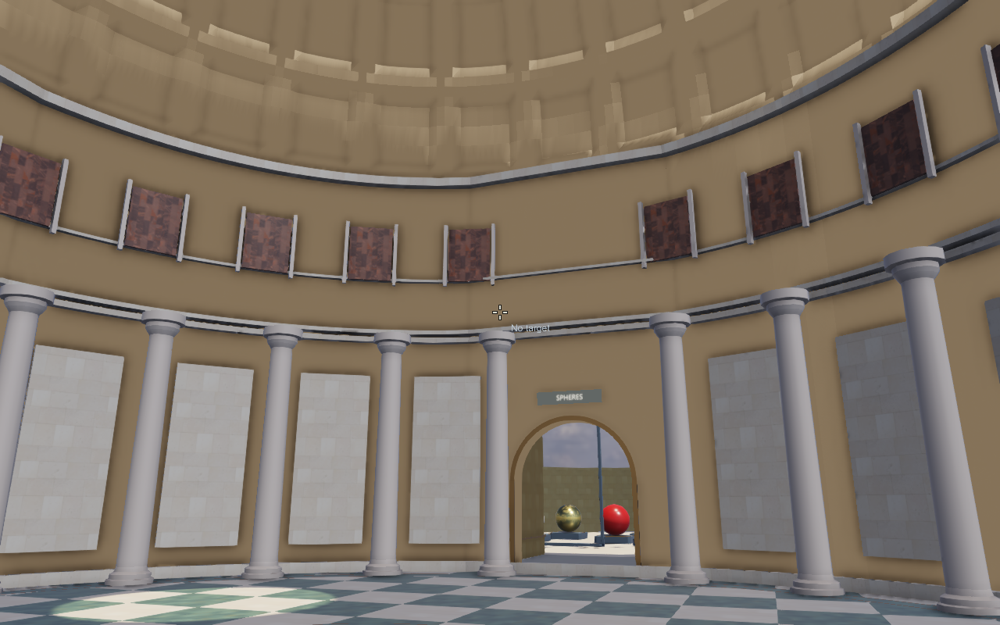
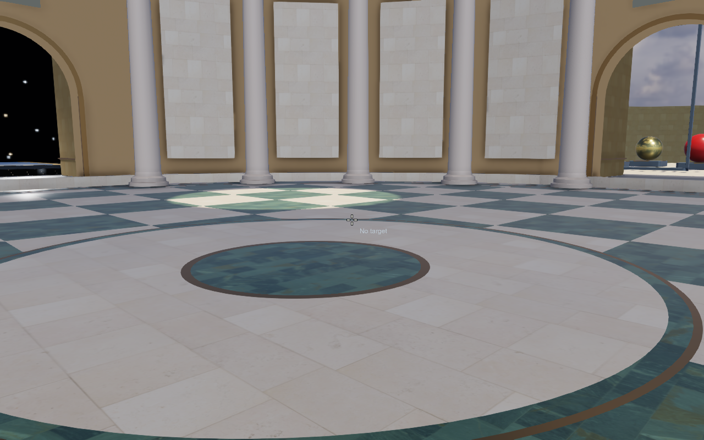

## Roterande ljus i legacyrummet, 2026-10-29

Takets ljuspaneler och den varma extralampan är borttagna. Den ursprungliga
RGBW-ljusringen är flyttad till legacyrummet med dess markörer och gemensamma
föräldransform. Rotationshastigheten är 38 grader per sekund.

`1`–`4` växlar färgerna, `5` solen. `T` och knappen **Light orbit** pausar
rotationen. Piltangenterna och Page Up/Page Down flyttar ljusringen.
Rumsnoden äger hela ljusringen och de ursprungliga ljusslotarna behålls.

Scenen har tio ljus inklusive strålkastare och ficklampa. Renderaren
stöder tio direkta ljus och högst åtta punktskuggkartor; skuggornas
texturenheter förblir separerade från miljötexturerna. Ljusmasken ryms
exakt i den befintliga RGBA16F-bufferten.

## Krasch vid byte till cubemaps, 2026-10-29

Kraschen är reproducerad i den riktiga scenen från rotundan:
`Invalid reflection cubemap layer count`. Den gemensamma texturarrayen
rymmer 16 cubemaps, men den gamla probräknaren kunde begära 15 lokala
prober utöver två himlar, totalt 17 lager.

Probbudgeten reserverar nu plats för samtliga himlar. I Pantheons rotunda
ryms därför 14 lokala prober och två himlar. Materialrummets nio prober
och stadens fyra byggnadsprober påverkas inte. Objekt som ligger utanför
budgeten behåller sin rumsspecifika miljöreflektion.

Det nya regressionstestet täcker även den maximala konfigurationen med
fyra himlar samt GPU-allokering och reservreflektion för övriga objekt.
Tidigare versionsrapporter följer nedan.

## Rumsmiljöer, cubemaps, skala och normalmappar, version 10, 2026-10-29

Den svarta stjärnrutan ovanför stadens gång är reproducerad och rättad.
Alla fyra rum deklarerar nu sin miljö. En annan rumsskybox får bara visas
om siktlinjen först passerar det egna rummets öppning. Samma kameravy med
den gamla miljökopplingen återskapar felet; rättningen tar bort 9 800 svarta
läckande bildpunkter.

- Cubemaps byggs om vid byte av rum. Materialrummet får nio reflektionsprober;
  varje byggnads våningar delar en probe och undantas tillsammans vid fångst.
  Efter uppvärmning är **20 av 20 bilder identiska**, utan flimmer.
- C-3PO, Altaïr och deras socklar är tre gånger större. Figurerna är cirka
  5,5 respektive 5,4 meter höga; socklarna är 9 × 9 × 1,05 meter.
- DoF använder avståndet till träffad geometri även när ytan inte är valbar.
  En stadsbild med fokus på 43,5 meter är visuellt kontrollerad. Portaltexturers
  djup återprojiceras däremot inte till huvudbildens djupbuffert.
- Kalksten och marmorgolv har tydligare OpenGL-normalmappar. En faktisk
  jämförelse med texturerna bortkopplade ändrar **141 794 bildpunkter**,
  högst 52 färgsteg. Glasgolvet behåller släta normaler.
- **24** skyboxtester, verkliga träff-/probkontroller samt motorns
  normalmapps- och antialiasingtester passerar.

De tidigare prestandamätningarna längre ner avser fortfarande version 2.

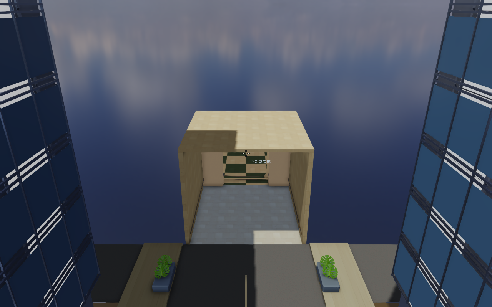
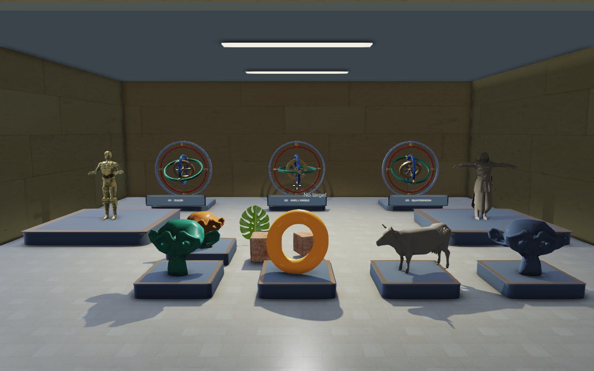

## Portaltexturer, valbarhet och stabila cubemaps, version 9, 2026-10-29

Dolda rum visas genom render-to-texture-ytor i deras öppningar. Destinations-
geometrin är fortsatt dold i huvudscenen. Drakrummets glasgolv får inte längre
en rektangel av den globala molnhimlen i sin reflektionsbakgrund.

- En faktisk stadsfångst från drakrummet verifierad: 124 × 111 texlar, 65 draw calls.
- Strålträffar i den verkliga scenen verifierade på övre våningens fasad,
  alpha-testade blad och samtliga tre gyroskop.
- Gyroskopskyltarna visar bara metodnamnet.
- Cubemapkontroll efter konvergens: **20 sparade bilder, 0 ändrade bildpunkter**.
- **22** GPU-/skytester och **217** scenegraphkontroller passerar.
- Vid denna version var orsaken till den svarta punkten ännu inte fastställd.
  Den senare stadsvyn och rättningen redovisas i version 10 ovan.
- Den korrigerade viewern är öppen med HUD och cubemaps aktiverade.

## Högre speglar, version 8, 2026-10-29

Spegelytorna är höjda från 7,28 till 12 meter. Överkanten ligger nu vid
12,35 m, över gångens tak på 10,3 m. Stolpar och överliggare följer den nya
höjden. Spegelvyn är flyttad bakåt så att hela ramen ryms. Färg och djup
är pixelidentiska med culling på/av, och resultatet är visuellt granskat.
Viewern är öppen i spegelrummet med HUD.

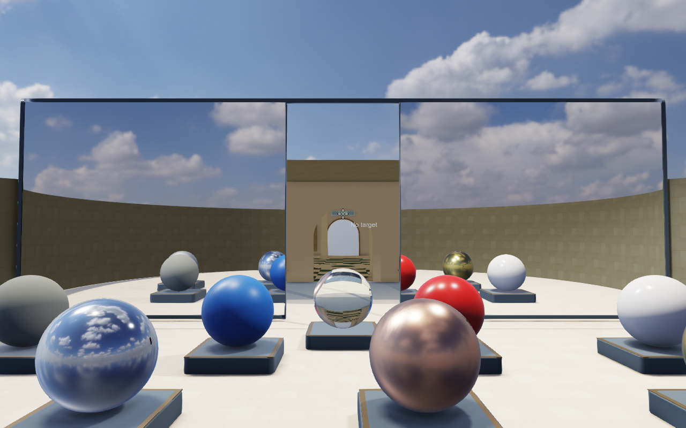

## Glasgolv och utsikt in i Pantheon, version 7, 2026-10-29

Pantheon syns åter genom gången. Dess geometri klipps per fragment till
dörröppningen, så att rotunda och kupol inte syns runt korridoren i rymden.
De övriga rumsvingarna förblir dolda.

Drakrummets yttervägg är borttagen. Golvet är en sluten 80 mm glasskiva,
IOR 1,52, med brytning genom parallella ytor och skivans cirkulära kant.
De tre mässingsringarna är kvar. Stjärnorna syns genom glaset under rummet.

- **217** scenegraphkontroller passerar med Pantheons öppningsmask.
- Tre relevanta kameror: **6/6** pixelidentiska färg/djupjämförelser med
  frustumculling på/av. Dörrvyn och glasgolvet har granskats visuellt.
- Glasskivans svetsade kanttopologi är sluten; samtliga tre ringar finns kvar.
- Befintliga material- och antialiasingtester passerar.
- Viewern är uppdaterad i `astra-exit` med synlig HUD och lämnas öppen.

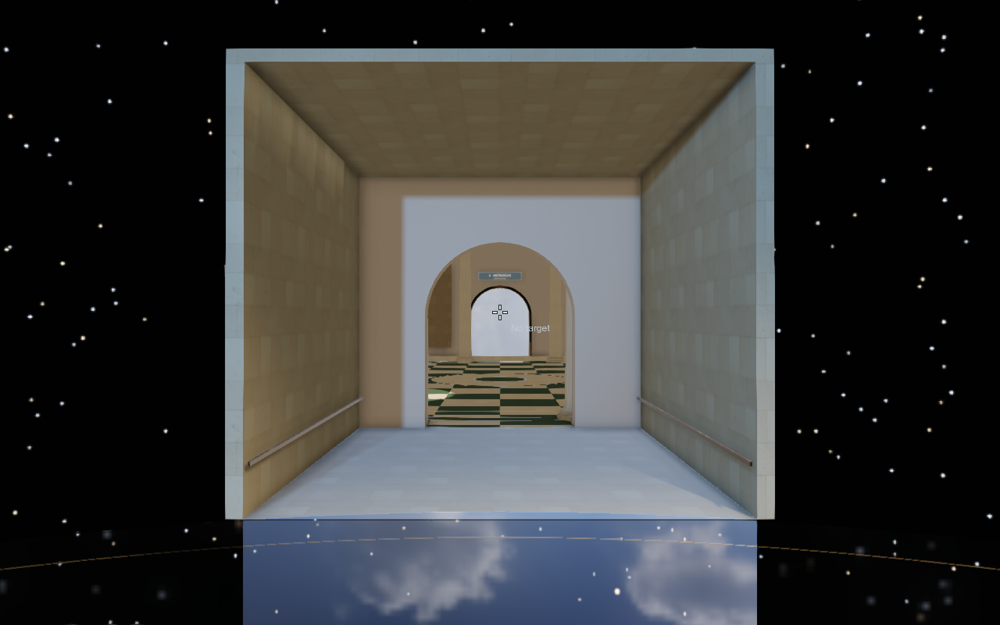
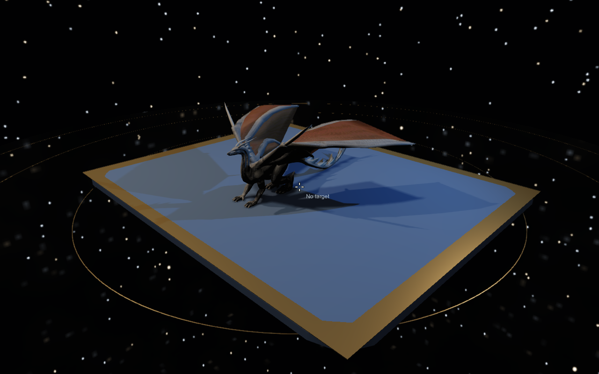

## Isolerade rum via scenegraphen, version 6, 2026-10-29

Inne i ett temarum visas bara dess eget delträd, inklusive den egna gången
mot Pantheon. Rotundan, kupolen och övriga rum döljs. När kameran går ut
i gången återställs tidigare synlighet. Detta sker genom nodernas synlighet
och fungerar därför i huvudbild, speglingar, reflektionsfångster och skuggor.
Skyboxarnas val genom öppningen behålls.

Ändringen ligger helt i experimentet. Gångarna är egna barngrupper under
rumsvingarna. En separat tom controllernod styr syskonens synlighet utan
att markera den statiska arkitekturen som animerad.

- **197 scenegraphkontroller** passerar: alla fyra rum, båda sidor av tröskeln,
  återställning, runda gränser, skuggor, ljusslotar och cullingundantag.
- Fem relevanta kameravyer ger **10/10 pixelidentiska** färg/djupjämförelser
  med frustumculling på/av. Den semantiska rumsisoleringen är aktiv i båda fallen.
- Egen rendering granskad: ingen omgivande rotunda eller andra vingar syns
  över stjärnrummets väggar; dess anslutningsgång finns kvar.


## Riktiga rumsskyboxar, version 5, 2026-10-29

Stjärn- och molnkupolerna är borttagna. Rendererns skyboxpass använder nu
separata HDR-cubemaptexturer och väljer miljö per siktlinje genom rummets
deklarerade öppning. Stjärnor och stadens molnhimmel visas samtidigt.
Diffus IBL och reservbakgrunder för reflektion/brytning följer samma miljöer.

- Oberoende CPU/GPU-masktest: **0 avvikande bildpunkter** från båda håll.
- Verklig dörrvy: **3 378** kontrollerade bildpunkter med stadshimmel är
  identiska med ASTRA:s skybox på/av; **93 122** bildpunkter visar stjärnhimlen.
- **18/18** nya färg/djupjämförelser och **44/44** ordinarie jämförelser
  är pixelidentiska med culling på/av, inklusive forward, deferred och MSAA.
- **22** skyboxtester samt motorns scenegraph-, material-, deferred- och
  antialiasingtester passerar. Gyroskopens matematiktester passerar också.
- Den nya viewern startades i `astra-exit`, med HUD, och lämnades öppen.

Skyboxar: 1024 texlar per kubsida; förfiltrerade reflektioner: 256 texlar,
nionivåers mipkedja. Resurserna bakas vid laddning. Prestandasiffrorna längre
ner gäller fortfarande version 2 och är inte nya mätningar.

[Skyboxkontroller](skybox-verification.json) · [Scen och start](README.md)

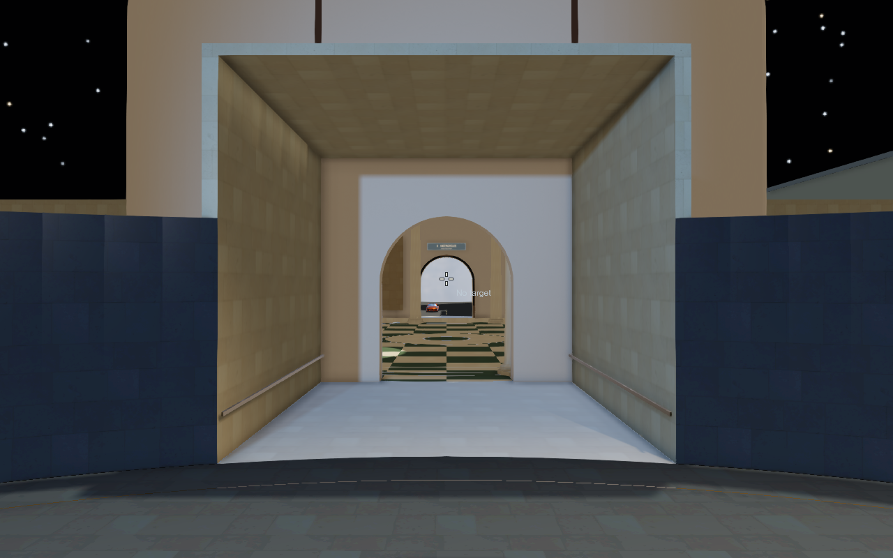

## Tre kopplade gyroskop, version 4, 2026-10-29

Böcker, hyllor och den gamla armillarsfären har ersatts med tre gyroskop:
Euler Y–X–Z, axel–vinkel och enhetskvaternioner med SLERP. Ringarna är
nästlade scengraphnoder med ihåliga lager, koaxiala tappar, genomgående
rotoraxel och ekrade svänghjul. Samma meshresurser återanvänds i alla tre.
Kvaternionbanans jämna första segment passerar 90° vid sekund 2; Euler-
exemplaret håller sin mittenaxel vid 90° under sekund 4–12.

- C++-kontroller av rotationsmatematik, SLERP, lång körning, paus, XML-omladdning,
  lagerkopplingar och ringarnas orientering passerar.
- Euler-styrningens determinant vid låsning: **−6,12 × 10⁻¹⁷** (numeriskt noll).
  Kvaternionens tre lokala rotationsriktningar: **1,0** (full rang).
- Sex levande poser, inklusive före/vid/efter 90°: **12/12 pixelidentiska
  färg/djupjämförelser** med culling på/av.
- 19 övriga kameravyer: **38/38 pixelidentiska jämförelser**. De tre justerade
  närbilderna kontrollerades igen efter kameraflytten.
- Alla sex gyroskopmeshar har slutna kanter. Lagertapparnas centrum förblir
  på föräldrarnas lageraxlar i de testade rörelserna.
- Befintliga scenegraph-tester passerar; material, 2 268 glasrutor, skalor och
  kontrollen av dörrskarvar passerar.

Kvarvarande mekanisk begränsning: fysiska gimbalaxlar kan sammanfalla även när
orienteringen lagras som kvaternion. Ringarnas inversa kinematik är separerad
från kvaternionbanan och används inte som dess tillstånd. De tre exemplaren
visar olika rörelsespår, inte identiska styrsignaler. Det separata svänghjulets
axelspinn är gemensamt för alla tre.

Scen, geometri, animationskod och egen startfil ligger i experimentmappen.
Endast en generell callbackregistrering för XML-animationer har lagts till i
bibliotekets Reader/SceneReader. Tidigare version finns i `history/v3`.
Viewern startades i vyn `gyroscopes` med synlig HUD och lämnades öppen.
Inga nya prestandamätningar görs gällande; siffrorna längre ner gäller version 2.

[Rotations- och bildkontroller](gyroscope-verification.json) · [Start och upplägg](README.md)

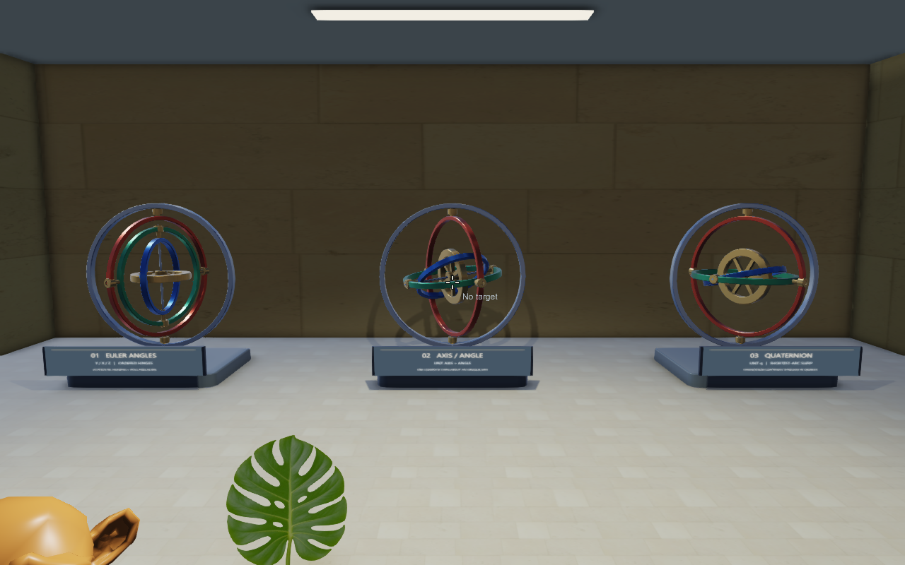

## Tidigare rättning: HUD och dörrskarvar, version 3, 2026-10-29

Den vanliga startens `--no-menus` har tagits bort. HUD och menyer visas nu
vid interaktiv start. Dolda benchmarkkörningar behåller flaggan.

Gångarna består nu av ett gemensamt U-format vägg/tak-skal som slutar vid
bågens baksida och rummets verkliga anslutning. Golven är skurna efter de
polygonkonturer som rotundan och sidorummen använder. En låg övergång ansluter
höjdskillnaden till det gamla infällda golvet utan överlapp. Dörrlisterna är
geringsskarvade mot de böjda listerna. Slutna byggdelar använder backface-culling.
Ingen depth bias eller polygon offset har lagts till.

- Kontroll av exponerade koplanära arkitekturytor i dörrzonerna: **69 ytpar före, 0 efter**.
- 16 närbilder från båda håll vid alla åtta gångskarvar: **32/32 pixelidentiska färg/djupjämförelser** med culling på/av.
- De vanliga 15 kameravyerna: **30/30 pixelidentiska färg/djupjämförelser**.
- Materialbevarande, glasrutornas slutenhet, skalor och resursreferenser passerade.
- Den tidigare scenen och dess generator finns i `history/v2`.

Överlappningskontrollen granskar axelparallella ytor i dörrzonerna. Interna,
motstående ensidiga kontaktändar och ensidiga basytor som vetter under golvet
räknas inte som exponerade. Den är inte en allmän självskärningskontroll av
samtliga importerade modeller.

Kör `python experiments/pantheon/verify_doorways.py` för skarvkontrollen.
Nedanstående prestandadata gäller version 2 från den 28 oktober; inga nya
bildtidsmätningar har gjorts som del av den här rättningen. Motorn och
standardscenen har inte ändrats.

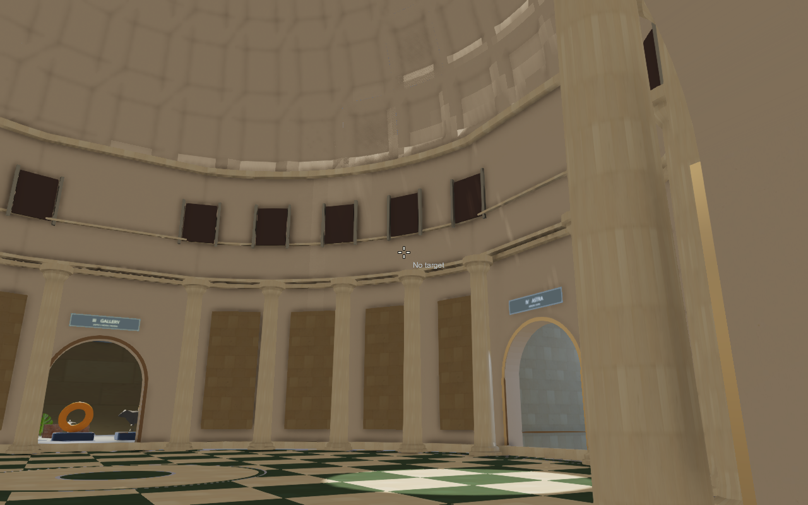

## Mätning av version 2, 2026-10-28

Rummen är utbyggda, de gamla modellerna och alla nio bollmaterial är bevarade,
och fyra befintliga byggnader har skalats till meter och fått geometriska glasfasader.
Motorkod, shaders och standardscen är oförändrade. Föregående prototyp finns i `history/v1`.

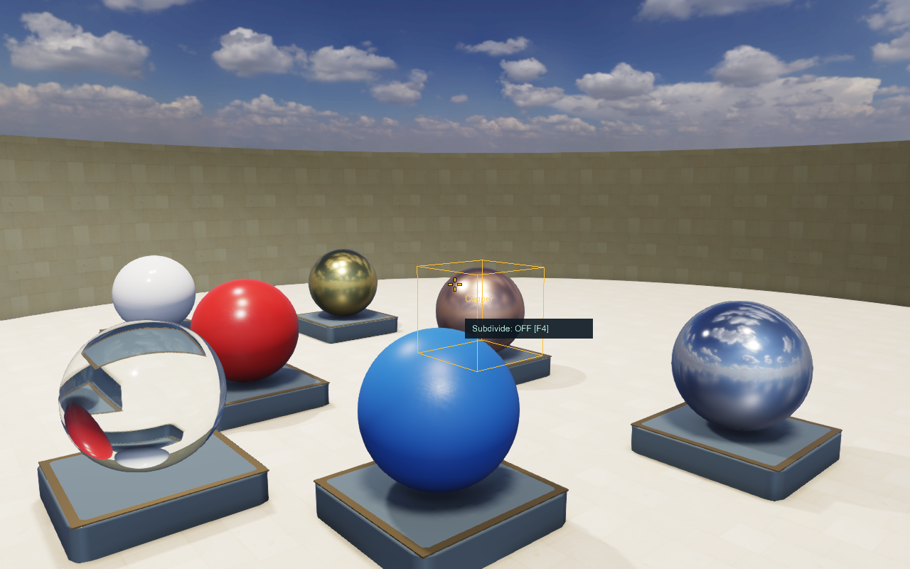

## Verifierat

- 15 kameravyer × färg och djup: **30/30 pixelidentiska jämförelser** med culling på/av.
- Drakens pose hålls vid exakt 0,5 s i samma befintliga Application under varje jämförelse. Prestandakörningarna har levande animation.
- Alla nio ursprungliga bollmaterials egenskaper matchar originalscenens XML. Alla ursprungliga modelltyper finns kvar.
- Spegel, drake och bil har sina ursprungliga interaktionsnamn. Bilens ljus och drakens klipp återanvänds.
- **2 268 slutna 12 mm glasrutor** verifierade med svetsad kanttopologi. IOR 1,52; roughness 0,055.
- Samtliga fyra torn använder uniform skala **0,01** och får **67,3–70,7 %** glasandel av sin rektangulära fasadarea.
- HDRI:ns checksumma, sex CC0-materialfiler och alla XML-resurser kontrollerades.
- Befintliga tester `scenegraph`, `culling`, `portals`: **3/3 passerade**.

## Prestanda

Intel Core i5-10600K, GTX 1080, drivrutin 560.94; 1280×800, deferred, Cook–Torrance,
FXAA, AO, skuggor, HDRI och fullupplöst spegel. VSync av; profileraren inklusive
prestandavyn aktiv. 600 bildrutor per vy, de sista 120 redovisas. Inga skärmbilder
togs under mätkörningarna.

| Vy | Medel, ms | P95, ms | FPS |
| --- | ---: | ---: | ---: |
| Rotunda | 15,96 | 17,07 | 62,67 |
| Kupol | 13,44 | 15,35 | 74,40 |
| Materialrum | 13,67 | 15,62 | 73,13 |
| Spegelvy | 19,09 | 22,76 | 52,40 |
| Stad | 16,24 | 17,36 | 61,59 |
| Galleri | 16,69 | 18,03 | 59,90 |
| Drake / stjärnhimmel | 16,64 | 18,29 | 60,11 |

Den utbyggda scenen ligger omkring **52–74 FPS** i dessa korta vyer. Den stora
spegelvyn och vissa P95-värden överskrider 16,67 ms; detta är ingen garanti om
60 FPS. Spegelupplösning, drakens animation och objektmaterial har behållits.
Spegelns entréplacering gör att den inte fångar en spegelbild från rotundan.
Rådata och CPU/GPU-delsteg finns i [benchmark.csv](benchmark.csv).

## Omfattning och gränser

Materialrum och planetarium är 48 m i diameter; arkivgalleriet är 42 × 44 m.
Staden är 64 × 78 m med endast fyra torn, cirka 47–105 m höga. Porschen är
cirka 1,98 × 4,55 m. Rummen ligger bakom separata anslutningsgångar och överlappar inte.
Spegelväggen är 36 × 7,28 m och lämnar en 6,48 m bred central passage.

Glas och metall är separata materialmeshar. Två våningsresurser delas mellan
alla fasadvåningar. Source-FBX och dess fönsterytor behålls i respektive
byggnadsgrupp. Glasets tjocklek och BSDF-parametrar finns i
`scene-manifest.json`. Byggnadernas inre rum är inte modellerade; denna version
är rasterrenderad och innehåller ingen raytracer eller separat IBL för varje rum.

Den separata portalvarianten har kvar det tidigare hittade närplansfelet.
Den nya auditen gav 229–5 478 ändrade pixlar vid trösklarna. Portaler är
avstängda i den vanliga scenen; frustumculling och LOD används.

[Fullständiga kontrollresultat](verification.json) · [Start och reproduktion](README.md)

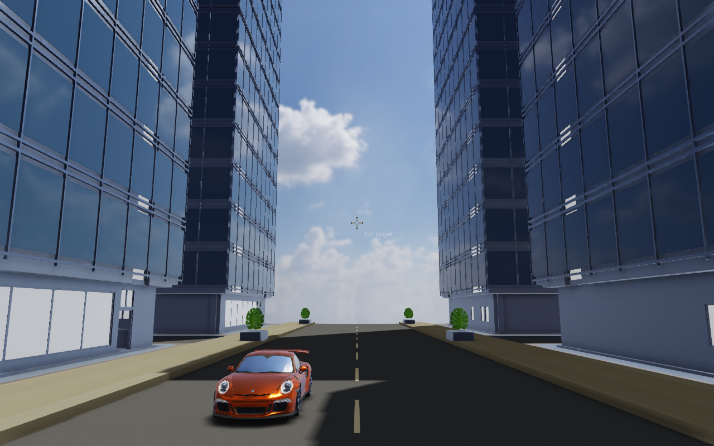

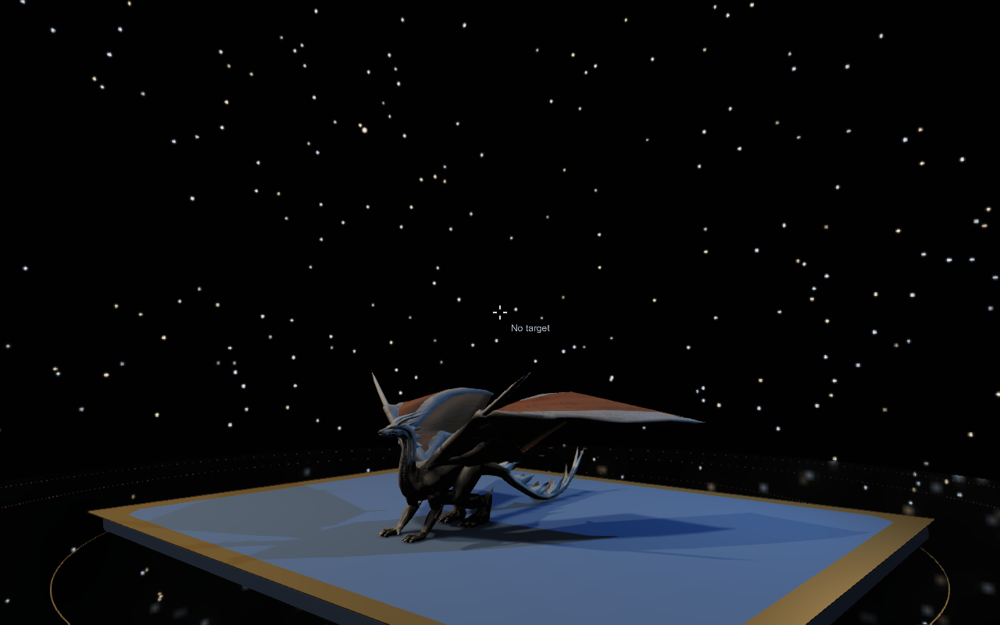


