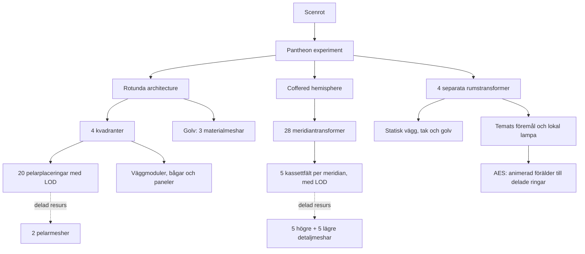

# Pantheon: avgränsat scenexperiment

En körbar Pantheon-inspirerad interiör för den befintliga C++/OpenGL-viewern.
Detta är ett försök för att utvärdera arkitektur, material, scenegraph och
realtidskostnad. Det är inte en inmätning eller en färdig slutscen.

Allt nytt ligger i den här katalogen. Motorkod, shaders, byggfiler,
standardscen och befintliga resurser har inte ändrats. Katalogen kan tas bort
utan att återställa andra filer. Inget nätverk behövs vid körning.

## Starta

Kör från repots rot efter att den vanliga viewern byggts enligt dess README:

```powershell
.\experiments\pantheon\run.ps1
.\experiments\pantheon\run.ps1 -View astra
.\experiments\pantheon\run.ps1 -View silva
```

Tillgängliga vyer: `rotunda`, `dome`, `lapis`, `aes`, `silva`, `astra`.
Höger musknapp + WASD flyttar kameran; Q/E flyttar i höjdled och Shift ökar
hastigheten. Space återställer den valda vyn. F1 visar prestanda, C växlar
frustumculling, Tab visar menyerna och R läser om scenen.

Startskriptet använder deferred, Cook–Torrance, FXAA och HDRI-reflektioner.
Viewerns övriga standardeffekter behålls. Direkt start med explicit resursrot:

```powershell
& .\build\windows\bin\viewer.exe --root . --scene experiments/pantheon/scene.xml --shading cook --aa fxaa
```

## Scenen och grafen

Rotundan har 43,3 m invändig diameter, en hemisfär som utgår från 21,65 m
och en öppen oculus med 8,92 m diameter. Den tänkta kompletta sfärens topp
är 43,3 m; kupolytan slutar lägre där öppningen börjar. Fem ringar med
28 kassettfält ger Pantheons tydliga struktur. Fyra 12 m djupa temarum är
egna tillägg, inte en historisk rekonstruktion av kapellen.

| Rum | Tema och innehåll |
| --- | --- |
| LAPIS, norr | Sten, marmorsfär, pelarprover och ljus puts |
| AES, öster | Brons, tre tunna ringar och en långsamt roterande armillarsfär |
| SILVA, söder | Trä, arkivhyllor, delade bokmeshar och öppen atlas |
| ASTRA, väster | Mörkblå väggar, stjärninläggningar och en himmelsglob |



XML beskriver placering, hierarki, materialärvning och LOD. `instance` pekar
på delade resurser; upprepningar blir inte nya kopior av vertexdata.
Golvmönstret är däremot ett litet statiskt objekt med tre materialmeshar,
inte en nod per kakelplatta. Väggen är uppdelad i rumsliga moduler så att
frustumculling kan välja bort delträd. Motorns befintliga instansiering,
tillståndscacher och skuggcache används utan specialfall för den här scenen.

`geometry.json` innehåller aktuella antal och mått. 623 skrivna instansnoder
inkluderar båda alternativen i 160 LOD-noder; de är inte 623 samtidiga draw
calls. De genererade meshresurserna har tillsammans 5 418 trianglar innan
placering och LOD-val. Viewerns delade standardklot och låda tillkommer.

## Material och ljus

Tre CC0-material från Poly Haven används som sex 1K-JPEG-filer: albedo och
OpenGL-normal för `marble_01`, `beige_wall_001` och `wood_table_001`.
Originalens storlekar, författare, URL:er och SHA-256 finns i `materials.json`.
Ingen tätt tessellerad skannad byggnad eller stora displacementkartor behövs.
Skyltarna genereras lokalt. Materialens roughness och metallic är konstanta;
det finns inga importerade roughnesskartor eller geometrisk displacement.

En riktad sol kastar skugga genom den riktiga öppningen, och varje temarum
har en stillastående lokal lampa. Stenens varma indirekta ljus är en
materialbaserad ambient approximation. Brons använder viewerns HDRI.
Scenen har ingen bakad GI, ljustransport eller volymetrisk ljusstråle.
Det här är medvetna avgränsningar i prototypen, inte ett påstående om
fysikaliskt korrekt eller "perfekt" slutrendering.

## Portaltestet är separat

`scene.xml` och `views/` använder frustumculling och LOD. De innehåller
ingen portaldefinition. Den opt-in-varianten `portal-scene.xml` beskriver
fyra rumsceller, rotundan som yttre region och fyra konservativa
rektangulära portaler runt de välvda öppningarna:

```powershell
.\experiments\pantheon\run.ps1 -Portals
```

Den befintliga motorn kan tappa bort hela motstående rummets föremål när
kameran står cirka 3 cm innanför portalplanet. En trolig orsak, utifrån
kodläsning och bildjämförelser, är att kamerans närplan klipper bort själva
portalen innan traversal når rotundan. Detta har inte rättats i motorn
som del av scenexperimentet. Rummens byggnadsskal saknar rums-ID även i
portalvarianten; de kan därför frustumcullas konservativt som arkitektur
medan rummens föremål används för att undersöka portalurvalet.

## Återskapa och verifiera

Python 3 med Pillow och NumPy krävs för verktygen; de behövs inte i viewern.
Generatorn använder Windows-fonten Segoe UI för skyltarna.

```powershell
# Behövs endast om de medföljande CC0-materialen ska hämtas på nytt:
python experiments/pantheon/fetch_materials.py
# Återskapa all geometri, alla XML-vyer och skyltarna utan nätverk:
python experiments/pantheon/generate.py
# Rendera 14 fasta vyer med/utan frustumculling, mät sex körbara vyer
# och dokumentera den separata portalvariantens tröskelfel:
python experiments/pantheon/verify.py --benchmark --audit-portals
# Endast en bildtidsmätning av den animerade standardscenen:
.\experiments\pantheon\run.ps1 -Benchmark
```

Verifieringen kontrollerar resursreferenser och texturchecksummor och
exporterar den riktiga DAG:en till `output/scenegraph.dot`. De 14 vyerna
omfattar kupol, rotunda, alla rum, utblickar och dörrtrösklar.
För pixeljämförelser hålls AES-animationen stilla; för mätning kör den.
Djupbilder jämförs separat utan FXAA och AO. De belysta bilderna får ha
högst 1 024 ändrade pixlar av 1 024 000 och högst 0,005 i genomsnittlig
kanalskillnad på skalan 0–255, för glesa rasteravvikelser vid modulskarvar
och LOD efter ändrad batchordning. Exakta avvikelser sparas; detta kallas
inte pixelidentiska belysta bilder. Portaltestets resultat redovisas
separat och ingår inte i godkännandet av den vanliga scenen.

`output/` innehåller bilder, loggar, råmätningar och detaljresultat och
ignoreras av Git. Sparade resultat från denna körning finns i
`verification.json` och `RESULTAT.md`.

## Referenser

- [Italiens kulturmyndighet: Pantheons mått och plan](https://direzionemuseiroma.cultura.gov.it/en/pantheon/historical-background/).
- [Rom stad: fem ringar med 28 kassettfält och oculus 8,92 m](https://www.turismoroma.it/en/places/pantheon).
- [Poly Haven: CC0-licensen](https://polyhaven.com/license),
  [Marble 01](https://polyhaven.com/a/marble_01),
  [Beige Wall 001](https://polyhaven.com/a/beige_wall_001),
  [Wood Table 001](https://polyhaven.com/a/wood_table_001).

Geometrin är egen, procedurmässigt skapad utifrån publicerade proportioner.
Inga modeller, fotografier eller ritningar från Pantheon har kopierats.
