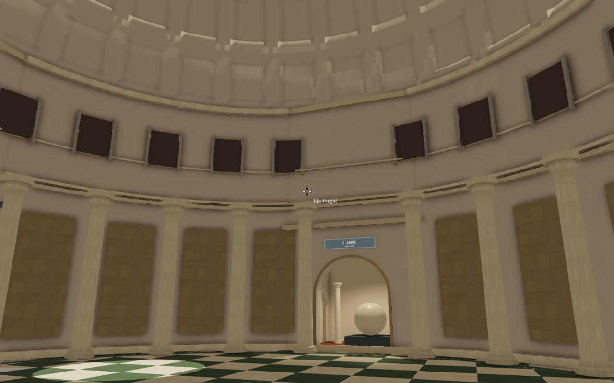
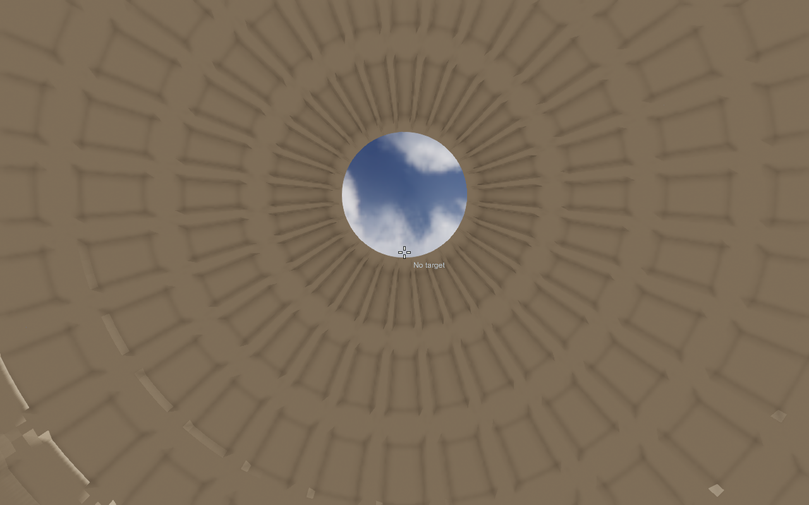
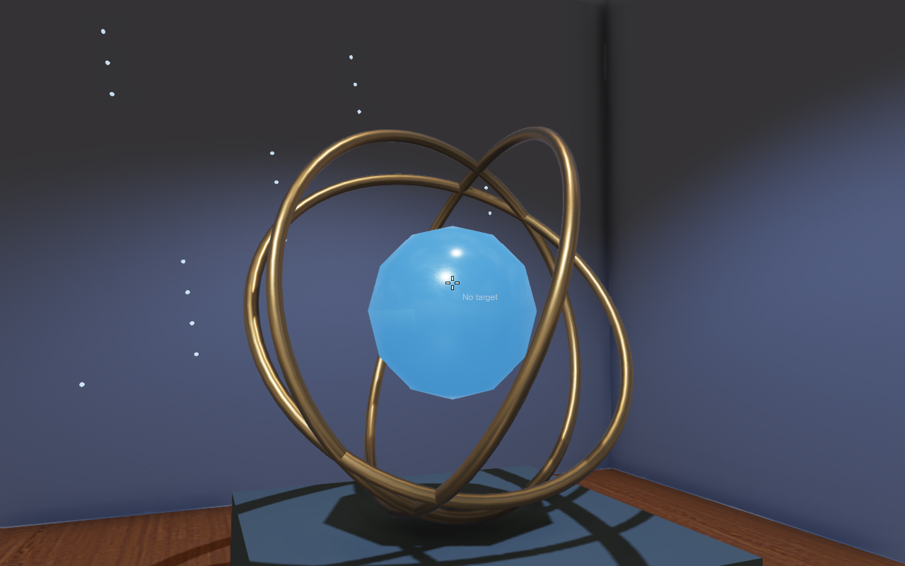

# Verifiering 2026-10-28

Den vanliga scenen går att köra i den befintliga viewern med marginal till
16,67 ms i de sex uppmätta vyerna. Motorn och projektets standardscen har
inte ändrats. Portalvarianten har ett reproducerat synlighetsfel och är
ett separat, avstängt experiment.

## Bildtid

Intel Core i5-10600K, NVIDIA GTX 1080, OpenGL 4.1 / drivrutin 560.94.
1280×800, deferred, Cook–Torrance, FXAA, AO, skuggor och HDRI-reflektioner.
VSync av, dolt fönster, profileraren och dess prestandavy aktiva.
AES-ringarna animeras. Frustumculling och LOD är på; portaler är av.
Varje vy kördes i 600 bildrutor; tabellen gäller de sista 120.

| Vy | Medel, ms | P95, ms | FPS |
| --- | ---: | ---: | ---: |
| Rotunda | 9,39 | 11,59 | 106,5 |
| Kupol | 8,33 | 10,50 | 120,0 |
| LAPIS | 9,60 | 11,97 | 104,2 |
| AES | 9,52 | 11,80 | 105,0 |
| SILVA | 10,05 | 12,09 | 99,5 |
| ASTRA | 9,49 | 11,45 | 105,4 |

Detta är korta, fasta kameramätningar, inte en lång kameravandring eller en
garanti för andra maskiner och inställningar. Inga skärmbilder togs i
mätkörningarna. [Rådata med CPU/GPU-delsteg](benchmark.csv) och
[inställningar och kontrollresultat](verification.json) är sparade.

I rotundavyn var GPU-renderingen 7,80 ms. AO stod för 3,12 ms och
G-buffer-geometri för 1,76 ms. Skuggorna tog 1,02 ms med i snitt fyra
skuggdraws per bildruta och återanvända statiska djupvyer. Detta pekar på
AO som ett större framtida GPU-spår än att ytterligare förenkla denna
redan lilla bygggeometri; ingen sådan motoroptimering ingår här.

## Synlighet och graf

- 14 fasta vyer med frustumculling på/av: **alla djupbilder pixelidentiska**.
- De belysta bilderna ändrades i 0–389 av 1 024 000 pixlar, högst 0,038 %.
  Största genomsnittliga kanalskillnaden var 0,00130 på skalan 0–255.
  Glesa rasteravvikelser finns vid modulskarvar/LOD när batchordningen ändras;
  belysta bilder påstås därför inte vara pixelidentiska.
- Alla sex texturchecksummor och XML-resurser kontrollerades.
- Den riktiga grafen exporterades till `output/scenegraph.dot`, inklusive
  delade resurser och båda LOD-nivåerna.
- Befintliga `scenegraph`, `culling` och `portals`: **3/3 passerade**.
  Dessa äldre tester täcker inte det nya portalfelet nedan.

Golvet importerades som tre materialmeshar. Kupolens 140 kassettfält
återanvänder fem högre och fem lägre detaljmeshar. Totalt finns 160 LOD-noder.
623 skrivna instansnoder inkluderar alternativen för LOD och är inte antalet
draw calls. De genererade meshresurserna har sammanlagt 5 418 trianglar
innan placering; delade standardprimitiver tillkommer.

## Separat portalbegränsning

I `portal-scene.xml` jämfördes kameror 3 cm innanför de fyra trösklarna,
vända mot rotundan, med portalculling på/av. Då ändrades 1 885–5 415 pixlar
och synliga föremål i motstående rum kunde försvinna. Portalpolygonen verkar
klippas av kamerans närplan innan traversal når nästa region. Det är en
orsaksbedömning från kod och bilder; motorn har inte ändrats för att rätta det.

`scene.xml`, alla vanliga startvyer och standardstarten undviker denna kodväg
genom att sakna portaldefinition. `-Portals` och `--audit-portals` finns
kvar för en senare undersökning. Se README för reproduktionskommandon.

