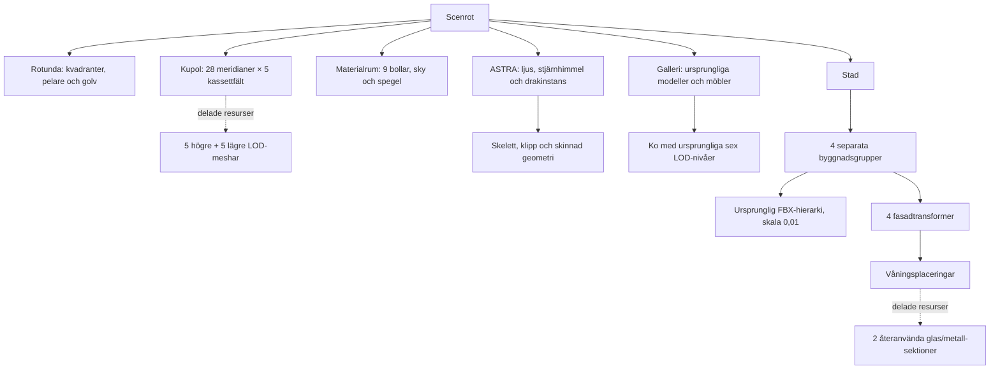

# Pantheon – stora temarum och återanvända objekt

En avgränsad scenprototyp för den befintliga C++/OpenGL-viewern. Rotundan
har kvar sin scenegraph, kupol, oculus och LOD; sidorummen har byggts ut
för den gamla scenens modeller och materialdemonstrationer.

Alla ändringar ligger i `experiments/pantheon`. Motorkod, shaders,
byggkonfiguration och standardscenen `scenes/house-patio.xml` är oförändrade.
Den första prototypens scen, generator, bilder och resultat finns i
`history/v1`. Inga nya modellpaket eller tjänster behövs vid körning.

## Start och vyer

Från repots rot:

```powershell
.\experiments\pantheon\run.ps1
.\experiments\pantheon\run.ps1 -View materials
.\experiments\pantheon\run.ps1 -View mirror
.\experiments\pantheon\run.ps1 -View city
.\experiments\pantheon\run.ps1 -View dragon
.\experiments\pantheon\run.ps1 -View gallery
```

De tidigare vynamnen `lapis`, `aes`, `silva` och `astra` fungerar också.
`rotunda` och `dome` visar centralrummet. `mirror` visar spegelväggen inifrån
materialrummet. Alla vyer laddar hela scenen och går att navigera vidare från.

Höger musknapp + WASD flyttar kameran, Q/E flyttar i höjdled och Shift ökar
hastigheten. Space återställer den valda vyn. F1 visar prestanda, C växlar
culling, Tab visar menyerna och R läser om scenen. De gamla objektens
picking, subdivision, drakens animationsval och bilens strålkastarknappar
har behållits. Starten använder deferred, Cook–Torrance, FXAA, AO, skuggor
samt den befintliga HDRI:n för ljus och reflektioner.

## Rummen

| Riktning / rum | Invändig storlek | Innehåll |
| --- | --- | --- |
| Norr / MATERIALS | Rund sal, 48 m diameter, 26 m höjd | Alla nio gamla materialbollar, glas, spegelvägg och den gamla molnhimlen |
| Öster / METROPOLIS | Gaturum 64 × 78 m | Fyra skyskrapor, glasfasader, Porsche i verklig storlek, trottoarer och planteringar |
| Söder / GALLERY | 42 × 44 m, 14 m höjd | Apor, ko med sex LOD-nivåer, torus, lådor, alpha-cutout, C-3PO, Altaïr, arkiv och armillarsfär |
| Väster / ASTRA | Rund sal, 48 m diameter, 30 m höjd | Den ursprungliga animerade draken, stjärnhimmel och en putsad utställningsö |

Anslutningsgångarna börjar vid rotundans fyra bågar och är cirka 13 m
långa. De stora salarna börjar 34 m från centrum; de ligger därför fria
från varandra. Den befintliga flygkamerans far plane är fortfarande 150 m.
Staden är avsiktligt liten och kan granskas från gatunivå.

Materialrummets spegelvägg är totalt 36 m bred och 7,28 m hög, med en
6,48 m bred genomgång i mitten. Den står på entrésidan och är vänd in mot
bollarna. Det ger fri passage och undviker spegelfångst från rotundan.
Båda spegelpartierna använder samma riktiga, fullupplösta plana reflektion.

## Skala och glas inför en senare raytracer

De fyra befintliga FBX-modellerna `ResidentialBuildings006`, `007`, `009`
och `010` används som strukturella kärnor med **enhetlig skala 0,01**.
Deras importerade bounds har mätts med Assimp, inklusive nodtransformationer.
De blir cirka 12,59 × 23,10 m i plan och 47,19 / 68,79 / 86,79 / 104,79 m
höga. Byggnaderna står på marken och har centrerats från sina verkliga bounds.
Porschen har skala 1 och är cirka 1,98 × 4,55 m i plan.

De gamla modellerna har separata `hotel_glas`-ytor. Utöver dessa finns
**2 268 nya slutna glasrutor**, med **12 mm tjocklek**, IOR **1,52** och
roughness **0,055**. Glaset täcker cirka 67–71 procent av tornens totala
rektangulära fasadarea. Metallprofiler och glas är separata materialmeshar.
De gamla inbakade reflektionsfotona och den kraftiga stål-normalmappen har
kopplats bort för tornen. Reflektionerna kommer från renderingen.

Rutorna är verkliga triangelytor, inte ett fönstermönster i en textur. En
våningssektion med fem eller nio rutor delas av alla motsvarande våningar.
Därmed behövs inte en graphnod per ruta. De slutna rutornas kanter verifieras
geometriskt. De gamla FBX-kärnorna har däremot inga färdigmodellerade rum
bakom curtain wall-fasaden; det behöver hanteras om framtida strålspårning
ska visa interiörer eller full volymetrisk transmission.

`building_catalog.json` innehåller importerade mått och källfilernas SHA-256.
`scene-manifest.json` innehåller rumsmått, modellskala, fönsteryta,
glasparametrar, modellinventering och skyreferens. Ingen raytracer ingår här.

## Scenegraph och material



Varje rum är ett eget transformdelträd. Varje torn har en byggnadsgrupp,
ursprunglig FBX, fyra fasadtransformer och instanser av våningssektionerna.
Upprepningar delar vertexdata; rum, byggnader och våningar kan frustumcullas.
De befintliga render- och skuggcacherna samt instansieringen används.
`geometry.json` skiljer skrivna instansnoder från unika meshresurser; antalet
instansnoder är inte antalet draw calls och inkluderar LOD-alternativ.

De tre små CC0-materialen från första försöket behålls. `materials.json`
anger filer, upphovspersoner, licens, URL och checksumma. Molnhimlens lokala
bakgrund härleds ur projektets befintliga HDRI med samma exponering som
viewern. Original-HDRI:n används fortfarande för global belysning och
reflektioner. ASTRA:s stjärnhimmel är ett separat lokalt, procedurmässigt
skapat tak. Detta är ingen implementation av separat IBL för varje rum.

## Verifiera och mäta

Verktygen kräver Python 3, Pillow, NumPy och Windows-fonten Segoe UI.
Den deterministiska bildkontrollen byggs med Visual Studio 2022 mot det
redan byggda `build/windows`-biblioteket. Den ändrar inte motorns bibliotek.

```powershell
python experiments/pantheon/generate.py
python experiments/pantheon/verify.py --benchmark --audit-portals
.\experiments\pantheon\run.ps1 -View materials -Benchmark
```

Verifieringen kontrollerar resursreferenser, materialbevarande, modelltyper,
HDR-checksumma, byggnadsskala och att glasrutorna är slutna. Den länkar samma
`Application` och renderer som viewern, avancerar animationen till exakt
0,5 s och jämför färg samt djup med culling på/av utan att ändra posen.
15 fasta vyer omfattar alla rum, spegeln, rotundan, kupolen, utblickar och
trösklar. De sju prestandavyerna körs däremot i den vanliga viewern med
levande animation under 600 bildrutor; de sista 120 sparas.

Resultat finns i `RESULTAT.md`, `verification.json` och `benchmark.csv`.
`output/` innehåller råbilder, loggar och den exporterade riktiga DAG:en i
`scenegraph.dot`, och ignoreras av Git.

## Separat portaltest

Den vanliga `scene.xml` och vyerna innehåller inga portaldefinitioner.
Frustumculling och LOD är aktiva. Den separata `portal-scene.xml` har rum och
anslutningsgångar som åtta celler. Kör med `run.ps1 -Portals` för att studera
motorns tidigare funna fel nära portalernas närplan. Den varianten kan tappa
synliga föremål vid en tröskel och är inte standardstarten. Auditresultaten
redovisas separat från den vanliga scenens kontroller.

## Källor och licenser

- Pantheonproportioner: [Italiens kulturmyndighet](https://direzionemuseiroma.cultura.gov.it/en/pantheon/historical-background/) och [Rom stad](https://www.turismoroma.it/en/places/pantheon).
- Texturer: [Poly Haven CC0](https://polyhaven.com/license); exakta resurser och upphovspersoner i `materials.json`.
- Återanvända modeller, drake och HDRI behåller projektets befintliga licenser och notices i repots README och modellmappar.
- Nya byggdelar, glaspartier, möbler och stjärnhimmel är lokalt genererade.
