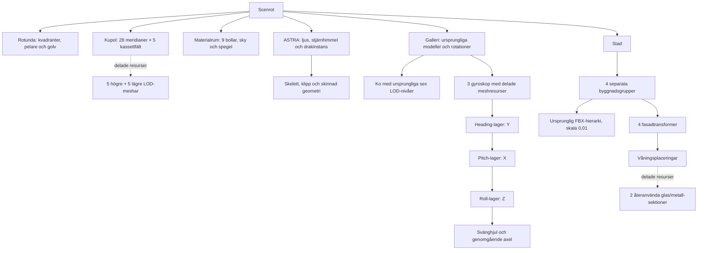

# Pantheon – stora temarum och återanvända objekt

En avgränsad scenprototyp för den befintliga C++/OpenGL-viewern. Rotundan
har kvar sin scenegraph, kupol, oculus och LOD; sidorummen har byggts ut
för den gamla scenens modeller och materialdemonstrationer.

Scen, modeller och gyroskopanimationer ligger i `experiments/pantheon`.
En liten generell registrering av XML-animationer har lagts till i `Reader`
och `SceneReader`; experimentets egen startfil registrerar gyroskopens callbacks.
Den vanliga viewern innehåller ingen gyroskopspecifik kod. Shaders,
huvudbyggets konfiguration och standardscenen `scenes/house-patio.xml` är oförändrade.
Tidigare versioners scen, generator och resultat finns i
`history/v1`, `history/v2` och `history/v3`. Inga nya modellpaket eller tjänster behövs vid körning.

## Start och vyer

Från repots rot:

```powershell
.\experiments\pantheon\build.ps1
.\experiments\pantheon\run.ps1
.\experiments\pantheon\run.ps1 -View materials
.\experiments\pantheon\run.ps1 -View mirror
.\experiments\pantheon\run.ps1 -View city
.\experiments\pantheon\run.ps1 -View dragon
.\experiments\pantheon\run.ps1 -View gallery
.\experiments\pantheon\run.ps1 -View gyroscopes
.\experiments\pantheon\run.ps1 -View euler
.\experiments\pantheon\run.ps1 -View axis-angle
.\experiments\pantheon\run.ps1 -View quaternion
```

De tidigare vynamnen `lapis`, `aes`, `silva` och `astra` fungerar också.
`rotunda` och `dome` visar centralrummet. `mirror` visar spegelväggen inifrån
materialrummet. Alla vyer laddar hela scenen och går att navigera vidare från.

Den vanliga starten visar HUD och menyer. Endast den dolda benchmarkkörningen
använder `--no-menus`. Tab döljer eller visar menyerna.

Höger musknapp + WASD flyttar kameran, Q/E flyttar i höjdled och Shift ökar
hastigheten. Space återställer den valda vyn. F1 visar prestanda, C växlar
culling, Tab visar menyerna och R läser om scenen. De gamla objektens
picking, subdivision, drakens animationsval och bilens strålkastarknappar
har behållits. Starten använder deferred, Cook–Torrance, FXAA, AO, skuggor
samt den befintliga HDRI:n för ljus och reflektioner.

## Rummen

| Riktning / rum | Invändig storlek | Innehåll |
| --- | --- | --- |
| Norr / MATERIALS | Rund sal, 48 m diameter, 26 m höjd | Alla nio gamla materialbollar, glas, spegelvägg och den gamla molnhimlen |
| Öster / METROPOLIS | Gaturum 64 × 78 m | Fyra skyskrapor, glasfasader, Porsche i verklig storlek, trottoarer och planteringar |
| Söder / GALLERY | 42 × 44 m, 14 m höjd | Apor, ko med sex LOD-nivåer, torus, lådor, alpha-cutout, C-3PO, Altaïr och tre mekaniskt kopplade gyroskop |
| Väster / ASTRA | Rund sal, 48 m diameter, 30 m höjd | Den ursprungliga animerade draken, stjärnhimmel och en putsad utställningsö |

Anslutningsgångarna börjar vid rotundans fyra bågar och är cirka 13 m
långa. De stora salarna börjar 34 m från centrum; de ligger därför fria
från varandra. Den befintliga flygkamerans far plane är fortfarande 150 m.
Staden är avsiktligt liten och kan granskas från gatunivå.

Materialrummets spegelvägg är totalt 36 m bred och 7,28 m hög, med en
6,48 m bred genomgång i mitten. Den står på entrésidan och är vänd in mot
bollarna. Det ger fri passage och undviker spegelfångst från rotundan.
Båda spegelpartierna använder samma riktiga, fullupplösta plana reflektion.

## Tre rotationer från föreläsningen

Böcker, bokhyllor och den gamla armillarsfären är borttagna. Tre gyroskop
står bredvid varandra längst bak i galleriet. De delar maskinbearbetade meshresurser,
med fasade metallringar, ihåliga bronslager, koaxiala lagertappar och ett
ekrat svänghjul med genomgående axel. Figurerna står längs sidorna.

| Exemplar | Orientering och demonstration |
| --- | --- |
| Euler | Intrinsisk ordning Y–X–Z: heading, pitch, roll. Under sekund 4–12 i en 20-sekundersloop hålls pitch vid 90°. Heading och roll drivs lika mycket och tar ut varandra när axlarna sammanfaller. Ringarna fortsätter röra sig; en frihetsgrad har försvunnit. |
| Axel–vinkel | En normaliserad, snedställd axel och en vinkel som gör ett helt varv på 20 sekunder. Matrisen beräknas direkt med axel–vinkel. |
| Kvaternion | Normaliserade enhetskvaternioner och SLERP mellan direkt skrivna axel–vinkelposer. Tecknet väljs för kortaste bågen; orienteringen fortsätter genom 90°. Inga Euler-vinklar interpoleras eller matas tillbaka till rotationsspåret. |

Alla tre har delträdet **fast ok → heading-lager → pitch-lager → roll-lager →
svänghjul**. För axel–vinkel och kvaternioner beräknas ringarnas gångjärnsvinklar
med invers kinematik från den färdiga orienteringen. Detta är en mekanisk
visualisering: även en kvaternionstyrd fysisk gimbal kan få sammanfallande
axlar. Kvaternioner tar bort rotationsrepresentationens singularitet, inte
mekanikens. Testet mäter därför oberoende rotationsriktningar direkt från
kvaternionen, separat från ringarnas visning.

De tre metoderna har olika rörelsespår; detta är ingen jämförelse av identiska
styrsignaler. Det vänstra exemplaret visar den specifika Euler-singulariteten.
Föreläsningsunderlaget är `lectures/5dv180_lecture2_acceleration_visibility_processing.txt`,
avsnittet om rotationer (cirka rad 910–1410).

`gyroscopes` visar hela raden; `euler`, `axis-angle` och `quaternion` visar
närbilder. R börjar om rotationsloopen. F fryser scenen för närmare granskning
och F igen återupptar den. HUD och menyer visas vid vanlig start.


## Skala och glas inför en senare raytracer

De fyra befintliga FBX-modellerna `ResidentialBuildings006`, `007`, `009`
och `010` används som strukturella kärnor med **enhetlig skala 0,01**.
Deras importerade bounds har mätts med Assimp, inklusive nodtransformationer.
De blir cirka 12,59 × 23,10 m i plan och 47,19 / 68,79 / 86,79 / 104,79 m
höga. Byggnaderna står på marken och har centrerats från sina verkliga bounds.
Porschen har skala 1 och är cirka 1,98 × 4,55 m i plan.

De gamla modellerna har separata `hotel_glas`-ytor. Utöver dessa finns
**2 268 nya slutna glasrutor**, med **12 mm tjocklek**, IOR **1,52** och
roughness **0,055**. Glaset täcker cirka 67–71 procent av tornens totala
rektangulära fasadarea. Metallprofiler och glas är separata materialmeshar.
De gamla inbakade reflektionsfotona och den kraftiga stål-normalmappen har
kopplats bort för tornen. Reflektionerna kommer från renderingen.

Rutorna är verkliga triangelytor, inte ett fönstermönster i en textur. En
våningssektion med fem eller nio rutor delas av alla motsvarande våningar.
Därmed behövs inte en graphnod per ruta. De slutna rutornas kanter verifieras
geometriskt. De gamla FBX-kärnorna har däremot inga färdigmodellerade rum
bakom curtain wall-fasaden; det behöver hanteras om framtida strålspårning
ska visa interiörer eller full volymetrisk transmission.

`building_catalog.json` innehåller importerade mått och källfilernas SHA-256.
`scene-manifest.json` innehåller rumsmått, modellskala, fönsteryta,
glasparametrar, modellinventering och skyreferens. Ingen raytracer ingår här.

## Scenegraph och material



Varje rum är ett eget transformdelträd. Varje torn har en byggnadsgrupp,
ursprunglig FBX, fyra fasadtransformer och instanser av våningssektionerna.
Upprepningar delar vertexdata; rum, byggnader och våningar kan frustumcullas.
De befintliga render- och skuggcacherna samt instansieringen används.
`geometry.json` skiljer skrivna instansnoder från unika meshresurser; antalet
instansnoder är inte antalet draw calls och inkluderar LOD-alternativ.

De tre små CC0-materialen från första försöket behålls. `materials.json`
anger filer, upphovspersoner, licens, URL och checksumma. Molnhimlens lokala
bakgrund härleds ur projektets befintliga HDRI med samma exponering som
viewern. Original-HDRI:n används fortfarande för global belysning och
reflektioner. ASTRA:s stjärnhimmel är ett separat lokalt, procedurmässigt
skapat tak. Detta är ingen implementation av separat IBL för varje rum.

## Verifiera och mäta

Verktygen kräver Python 3, Pillow, NumPy och Windows-fonten Segoe UI.
Den deterministiska bildkontrollen byggs med Visual Studio 2022 mot det
`build/windows`-biblioteket. `build.ps1` bygger biblioteket och experimentets
egen viewer, bildverktyg och tester i `output/capture-build`.

```powershell
python experiments/pantheon/generate.py
.\experiments\pantheon\build.ps1
python experiments/pantheon/verify_gyroscopes.py
python experiments/pantheon/verify.py --benchmark --audit-portals
python experiments/pantheon/verify_doorways.py
.\experiments\pantheon\run.ps1 -View materials -Benchmark
```

Verifieringen kontrollerar resursreferenser, materialbevarande, modelltyper,
HDR-checksumma, byggnadsskala och att glasrutorna är slutna. Den länkar samma
`Application` och renderer som viewern, avancerar animationen till exakt
0,5 s och jämför färg samt djup med culling på/av utan att ändra posen.
19 fasta vyer omfattar alla rum, gyroskopen, spegeln, rotundan, kupolen,
utblickar och trösklar. Prestandakörningen använder levande animation under
600 bildrutor per förvald kameravy; de sista 120 sparas.

`verify_gyroscopes.py` kontrollerar att böckerna och hyllorna är borta,
ringarnas föräldraskap och att de genererade gyroskopmesharna är slutna.
C++-testet mäter Euler-styrningens rangförlust vid 90° och kvaternionstyrningens
tre oberoende riktningar, SLERP:s vinkelhastighet, normalisering, paus/omladdning,
lagertapparnas positioner och att ringarna följer den beräknade orienteringen.
Sex levande poser jämförs med culling på/av, inklusive precis före, vid och
efter kvaternionens 90°-passage. Resultatet sparas i `gyroscope-verification.json`.

`doorway_audit.py` söker exponerade, koplanära arkitekturytor vid båda ändarna
av varje gång. `verify_doorways.py` kontrollerar också 16 närbilder från båda
håll. Golven är skurna efter de riktiga polygonkonturerna, vägg/tak bildar ett
gemensamt U-format skal och dörrlisterna är geringsskarvade mot rotundan.
Interna kontaktändar dupliceras inte. Detta rättar skarvgeometrin utan depth bias.

Resultat finns i `RESULTAT.md`, `verification.json` och `benchmark.csv`.
`output/` innehåller råbilder, loggar och den exporterade riktiga DAG:en i
`scenegraph.dot`, och ignoreras av Git.

## Separat portaltest

Den vanliga `scene.xml` och vyerna innehåller inga portaldefinitioner.
Frustumculling och LOD är aktiva. Den separata `portal-scene.xml` har rum och
anslutningsgångar som åtta celler. Kör med `run.ps1 -Portals` för att studera
motorns tidigare funna fel nära portalernas närplan. Den varianten kan tappa
synliga föremål vid en tröskel och är inte standardstarten. Auditresultaten
redovisas separat från den vanliga scenens kontroller.

## Källor och licenser

- Pantheonproportioner: [Italiens kulturmyndighet](https://direzionemuseiroma.cultura.gov.it/en/pantheon/historical-background/) och [Rom stad](https://www.turismoroma.it/en/places/pantheon).
- Texturer: [Poly Haven CC0](https://polyhaven.com/license); exakta resurser och upphovspersoner i `materials.json`.
- Återanvända modeller, drake och HDRI behåller projektets befintliga licenser och notices i repots README och modellmappar.
- Nya byggdelar, glaspartier, gyroskop och stjärnhimmel är lokalt genererade.
